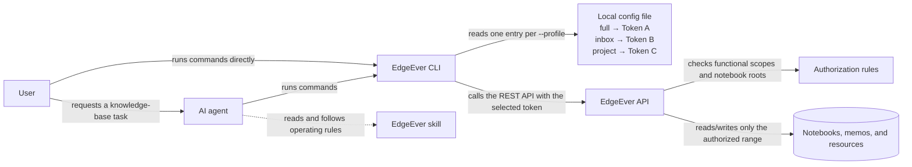

# EdgeEver CLI and Skill User Guide

[简体中文](edgeever-cli-skill-guide.zh-CN.md)

This guide is for people who use the CLI directly or ask an AI agent to operate EdgeEver. It targets EdgeEver server `2.28.2`, CLI `0.8.1`, and file-workspace protocol `1`. See the [CLI README](../cli/README.md) for the complete command and implementation reference, and the [file-workspace documentation](file-workspace.md) for storage and recovery details.

## 1. How the CLI, skill, profiles, and tokens relate

This is a usage/call diagram, not an execution sequence. Solid arrows mean active use or calls. The dashed arrow means the agent reads operational instructions from the skill; the skill is not a running process.



- The CLI is the program that connects to the server and reads or modifies data.
- The skill contains operating rules for an agent. It stores no token and does not execute requests by itself.
- One profile stores one instance base URL and one token.
- One config file can contain multiple profiles, but a command uses only one.
- The server checks both the token's functional permissions and notebook boundary.

## 2. Start in five minutes

Check the CLI first:

```sh
edgeever --version
edgeever profile list
edgeever skill status
```

In the EdgeEver Web app, open **Profile** → **API / MCP** and create a token for this client. Choose read-only access for queries, or grant the required write permissions for creation, editing, or synchronization. The full token is shown only when it is created. Never put it in a repository, memo, or skill.

The CLI uses the instance base URL without `/mcp`. To avoid storing a literal token in shell history, first read it into a hidden variable in Bash/Zsh, which support `read -s`:

```sh
read -s EDGEEVER_NEW_TOKEN
edgeever profile set work --url https://notes.example.com --token "$EDGEEVER_NEW_TOKEN"
unset EDGEEVER_NEW_TOKEN
```

Then perform a read-only check:

```sh
edgeever --profile work notebooks
edgeever --profile work search 'test'
```

`edgeever profile list` shows profile names, URLs, and whether a token exists. It never prints token values.

## 3. A token has two permission layers

Every token has two boundaries:

1. **Functional scopes** decide whether it may read memos, write memos, read resources, or create notebooks.
2. **Notebook boundary** can cover all notebooks or one or more selected notebook roots and all their descendants.

Common combinations:

| Use | Main required scopes |
| --- | --- |
| List notebooks, search, and read memos | `read:notebooks`, `read:memos` |
| Create or update memos | The read scopes above plus `write:memos` |
| Full file-workspace synchronization | `read:notebooks`, `read:memos`, `write:memos`, `read:resources`, `write:resources` |
| Create notebooks through the CLI | `read:notebooks`, `write:notebooks` |

A notebook boundary is not a per-memo grant. `get MEMO_ID` or `update MEMO_ID` targets one memo for that command but cannot widen the token's authority. To isolate one memo, place it in a dedicated notebook and scope the token to that notebook.

## 4. Use multiple tokens with one CLI

The recommended setup stores several named profiles in the default `~/.edgeever/config.json`:

```sh
edgeever profile set full --url https://notes.example.com --token "$FULL_TOKEN"
edgeever profile set inbox --url https://notes.example.com --token "$INBOX_TOKEN"
edgeever profile set project --url https://notes.example.com --token "$PROJECT_TOKEN"
```

Select one identity for each command:

```sh
edgeever --profile full notebooks
edgeever --profile inbox search 'pending'
edgeever --profile project get MEMO_ID
```

When multiple profiles share a URL, the CLI does not guess which one a workspace should use. An omitted profile produces `Multiple profiles match this workspace`; pass an explicit `--profile`.

`EDGEEVER_URL` and `EDGEEVER_TOKEN` override the selected profile. If profiles are the intended source of identity, first make sure the current shell has no stale overrides:

```sh
unset EDGEEVER_URL EDGEEVER_TOKEN
```

For file-level isolation between accounts, servers, or automation jobs, select a different config file:

```sh
EDGEEVER_CONFIG="$HOME/.edgeever/project.json" \
  edgeever profile set default --url https://notes.example.com --token "$PROJECT_TOKEN"

EDGEEVER_CONFIG="$HOME/.edgeever/project.json" \
  edgeever --profile default notebooks
```

The CLI has no `--config` flag; `EDGEEVER_CONFIG` selects the path.

## 5. Operate on one memo

Search and obtain a `MEMO_ID` first:

```sh
edgeever --profile work search 'upstream upgrade'
edgeever --profile work get MEMO_ID
```

Export one memo:

```sh
edgeever --profile work export MEMO_ID --out /absolute/path/note.md
```

Read the complete memo before editing it, then submit a complete body:

```sh
edgeever --profile work update MEMO_ID --body-file /absolute/path/note.md
```

The CLI obtains an edit session and checks the revision/hash. If the remote content changed, it stops and reports a conflict instead of falling back to an unguarded overwrite. Prefer `workspace sync` for memos already tracked in a local workspace because the workspace retains the baseline required for three-way merging.

Create, move, and merge:

```sh
edgeever --profile work create --notebook NB_ID --title 'Title' --body-file ./note.md
edgeever --profile work move --notebook NB_ID MEMO_ID
edgeever --profile work merge MEMO_ID_1 MEMO_ID_2
```

Ordinary `create` and `update` reject the top-level `edgeever:` front matter reserved by the CLI. Use `workspace import` for a new local Markdown file so the CLI can assign its real ID.

## 6. Synchronize local Markdown by notebook

A selected notebook includes its descendants by default. `--shallow` selects only that level; separate multiple root IDs with commas:

```sh
edgeever --profile project workspace link "$HOME/EdgeEver/project" --notebooks NB_ROOT
edgeever --profile project workspace link "$HOME/EdgeEver/shallow" --notebooks NB_ROOT --shallow
edgeever --profile project workspace link "$HOME/EdgeEver/multi" --notebooks NB_ONE,NB_TWO
```

Preview before applying:

```sh
edgeever --profile project workspace sync "$HOME/EdgeEver/project" --dry-run
edgeever --profile project workspace sync "$HOME/EdgeEver/project"
```

From a linked folder or any child directory, use the shorter form:

```sh
edgeever --profile project sync --dry-run
edgeever --profile project sync --json
```

Tokens with different notebook boundaries should use different local directories. Do not alternate an unrestricted and restricted token against one `.edgeever` workspace index; the saved synchronization scope may disagree with the current credential's visibility.

Synchronization never turns a local deletion into a cloud deletion. New untracked files are reported but not read or imported automatically. Import explicitly:

```sh
edgeever --profile project workspace import "$HOME/EdgeEver/project" \
  --file relative/note.md --notebook NB_ID
```

Exit code `0` means the command completed, `1` is an error, and `2` reports conflicts or another state that needs attention. Never delete `.edgeever/state.json`, baselines, or recovery journals to bypass an error.

## 7. Install and use the agent skill

The skill ships at the same version as the CLI. Installing or updating it neither reads tokens nor contacts the server:

```sh
edgeever skill install --target claude
edgeever skill install --target codex
edgeever skill install --target kimi
edgeever skill status
```

A shared agent environment can use a custom skills parent directory:

```sh
edgeever skill install --dir "$HOME/.agents/skills"
```

If `~/.agents/skills/edgeever` is already a symlink to the Claude skill, update the real Claude directory rather than asking the installer to overwrite the link:

```sh
edgeever skill update --target claude
```

After installing a newer CLI, update the skill explicitly:

```sh
edgeever skill update --target claude
```

Start a new agent session after installation. Example requests:

```text
Use the EdgeEver skill with the work profile to search for “upstream upgrade”. Analyze only; do not modify anything.
```

```text
Use the EdgeEver skill with the project profile to dry-run synchronization for the current workspace. Report problems, but do not run the real sync.
```

The agent runs the CLI. The skill only governs profile selection, read-before-write behavior, conflict handling, and credential safety.

## 8. Troubleshooting

| Symptom | Action |
| --- | --- |
| `EDGEEVER_TOKEN is required` | Configure a token with `profile set`, or provide it through a local environment variable. Never send a token in chat. |
| `Multiple profiles match this workspace` | Add `--profile NAME` to this command. |
| `401 invalid_token` | Check the instance address and whether the token belongs to it. Replace revoked or leaked tokens. |
| `403` | The token lacks a functional scope, or the target memo is outside its notebook boundary. |
| `Server lacks atomic file-workspace/attachment support` | The server does not have the compatible file-workspace extension. Do not bypass the capability check. |
| Synchronization exits with `2` | Inspect the JSON summary, conflict draft, or recovery state before retrying. |
| `skill status` disagrees with a shared skill | Inspect the real directory and symlink target. The default `codex` status only checks the default Codex directory. |

Complete file-workspace behavior remains unverified on Windows. Back up existing data and start with `--dry-run` there.
