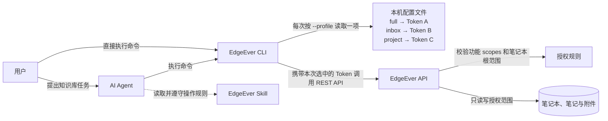

# EdgeEver CLI 与 Skill 使用手册

[English](edgeever-cli-skill-guide.md)

本手册面向使用 CLI 或让 AI Agent 操作 EdgeEver 的用户。当前适配 EdgeEver 服务端 `2.28.2`、CLI `0.8.2` 和文件工作区协议 `1`。完整命令及实现细节见 [CLI README](../cli/README.zh-CN.md)，文件工作区的存储和恢复细节见[文件工作区说明](file-workspace.zh-CN.md)。

## 1. CLI、Skill、Profile 和 Token 的关系

下图是使用与调用关系，不表示执行顺序。实线表示主动使用或调用，虚线表示 Agent 读取 Skill 的操作规则；Skill 不是独立运行的程序。



- CLI 是实际连接服务器、读取或修改数据的程序。
- Skill 是给 Agent 的操作规则，不保存 Token，也不代替 CLI 执行请求。
- 一个 Profile 保存一个实例根地址和一个 Token。
- 一个配置文件可以保存多个 Profile，但一次命令只使用其中一个。
- 服务端同时检查 Token 的功能权限和笔记本范围。

## 2. 五分钟开始

先检查 CLI：

```sh
edgeever --version
edgeever profile list
edgeever skill status
```

在 EdgeEver Web 的 **个人中心** → **API / MCP** 中为当前客户端创建 Token。只查询时选择只读权限，需要创建、修改或同步时授予相应写权限。Token 只会在创建时完整显示；不要把它写入仓库、笔记或 Skill。

CLI 使用实例根地址，不要在地址末尾添加 `/mcp`。为避免真实 Token 进入 shell 历史，可在支持 `read -s` 的 Bash/Zsh 中先静默读取变量：

```sh
read -s EDGEEVER_NEW_TOKEN
edgeever profile set work --url https://notes.example.com --token "$EDGEEVER_NEW_TOKEN"
unset EDGEEVER_NEW_TOKEN
```

然后做只读验证：

```sh
edgeever --profile work notebooks
edgeever --profile work search '测试'
```

`edgeever profile list` 只显示 Profile 名、URL 和是否存在 Token，不输出 Token 本身。

## 3. Token 的两层权限

每个 Token 有两层边界：

1. **功能 scopes**：决定能否读取笔记、写入笔记、读取附件或创建笔记本。
2. **笔记本范围**：可以是全部笔记本，也可以是一个或多个所选笔记本根及其全部子笔记本。

常见用途如下：

| 用途 | 需要的主要 scopes |
| --- | --- |
| 列出笔记本、搜索和读取笔记 | `read:notebooks`、`read:memos` |
| 创建或修改笔记 | 上述读取权限，加 `write:memos` |
| 完整文件工作区同步 | `read:notebooks`、`read:memos`、`write:memos`、`read:resources`、`write:resources` |
| 通过 CLI 创建笔记本 | `read:notebooks`、`write:notebooks` |

笔记本范围不是单篇笔记授权。`get MEMO_ID` 或 `update MEMO_ID` 只表示本次命令操作一篇笔记，不能扩大 Token 权限。若必须让一个 Token 只访问一篇笔记，应把该笔记放进专用笔记本，再把 Token 限定到这个笔记本。

## 4. 一个 CLI 使用多个 Token

推荐在默认配置文件 `~/.edgeever/config.json` 中保存多个命名 Profile：

```sh
edgeever profile set full --url https://notes.example.com --token "$FULL_TOKEN"
edgeever profile set inbox --url https://notes.example.com --token "$INBOX_TOKEN"
edgeever profile set project --url https://notes.example.com --token "$PROJECT_TOKEN"
```

每次显式选择身份：

```sh
edgeever --profile full notebooks
edgeever --profile inbox search '待处理'
edgeever --profile project get MEMO_ID
```

同一 URL 存在多个 Profile 时，CLI 不会猜测工作区应使用哪一个；未指定时会提示 `Multiple profiles match this workspace`。传入明确的 `--profile` 即可。

环境变量 `EDGEEVER_URL` 和 `EDGEEVER_TOKEN` 的优先级高于选定的 Profile。如果计划统一使用 Profile，先确认当前 shell 没有遗留覆盖：

```sh
unset EDGEEVER_URL EDGEEVER_TOKEN
```

需要把账号、服务器或自动化任务在文件层面完全隔离时，使用不同的配置文件：

```sh
EDGEEVER_CONFIG="$HOME/.edgeever/project.json" \
  edgeever profile set default --url https://notes.example.com --token "$PROJECT_TOKEN"

EDGEEVER_CONFIG="$HOME/.edgeever/project.json" \
  edgeever --profile default notebooks
```

CLI 没有 `--config` 参数；配置文件路径通过 `EDGEEVER_CONFIG` 指定。

## 5. 按单篇笔记操作

先搜索并取得 `MEMO_ID`：

```sh
edgeever --profile work search '上游升级'
edgeever --profile work get MEMO_ID
```

导出一篇笔记：

```sh
edgeever --profile work export MEMO_ID --out /absolute/path/note.md
```

修改前先读取完整笔记，再提交完整正文：

```sh
edgeever --profile work update MEMO_ID --body-file /absolute/path/note.md
```

CLI 会取得 edit session 并校验 revision/hash。远端已经变化时会停止并报告冲突，不会降级为无保护覆盖。受管工作区内的笔记应优先通过 `workspace sync` 修改，因为工作区保留三方合并所需的基线。

创建、移动和合并：

```sh
edgeever --profile work create --notebook NB_ID --title '标题' --body-file ./note.md
edgeever --profile work move --notebook NB_ID MEMO_ID
edgeever --profile work merge MEMO_ID_1 MEMO_ID_2
```

普通 `create`/`update` 不接受 CLI 保留的顶层 `edgeever:` front matter。新的本地 Markdown 文件应使用 `workspace import` 取得真实 ID。

## 6. 按笔记本同步本地 Markdown

一个选中笔记本默认包含其子笔记本。`--shallow` 只选择当前层；多个根 ID 用逗号分隔：

```sh
edgeever --profile project workspace link "$HOME/EdgeEver/project" --notebooks NB_ROOT
edgeever --profile project workspace link "$HOME/EdgeEver/shallow" --notebooks NB_ROOT --shallow
edgeever --profile project workspace link "$HOME/EdgeEver/multi" --notebooks NB_ONE,NB_TWO
```

先预览，再执行：

```sh
edgeever --profile project workspace sync "$HOME/EdgeEver/project" --dry-run
edgeever --profile project workspace sync "$HOME/EdgeEver/project"
```

在已链接目录或其子目录中可以简化为：

```sh
edgeever --profile project sync --dry-run
edgeever --profile project sync --json
```

不同笔记本权限的 Token 应使用不同本地目录。不要让全权限 Token 和受限 Token 交替同步同一个 `.edgeever` 工作区索引，否则保存的同步范围可能与当前凭据的可见范围不一致。

同步不会把本地删除传播成云端删除；未跟踪的新文件只会报告，不会自动读取或导入。导入新文件需显式执行：

```sh
edgeever --profile project workspace import "$HOME/EdgeEver/project" \
  --file relative/note.md --notebook NB_ID
```

退出码 `0` 表示命令完成，`1` 表示错误，`2` 表示已报告冲突或需要处理的状态。不要删除 `.edgeever/state.json`、基线或恢复日志来绕过错误。

## 7. 安装和使用 Agent Skill

Skill 随 CLI 同版本分发，安装或更新 Skill 不会读取 Token，也不会连接服务器：

```sh
edgeever skill install --target claude
edgeever skill install --target codex
edgeever skill install --target kimi
edgeever skill status
```

共享 Agent 环境可以指定技能父目录：

```sh
edgeever skill install --dir "$HOME/.agents/skills"
```

如果 `~/.agents/skills/edgeever` 已经是指向 Claude Skill 的软链，应更新真实的 Claude 目录，而不是让安装器覆盖软链：

```sh
edgeever skill update --target claude
```

CLI 安装新版后，再显式更新 Skill：

```sh
edgeever skill update --target claude
```

安装后新开 Agent 会话。可以直接提出任务，例如：

```text
使用 EdgeEver Skill，通过 work Profile 搜索“上游升级”，只分析，不修改。
```

```text
使用 EdgeEver Skill，通过 project Profile 对当前工作区执行一次 dry-run 同步；有问题只报告，不执行正式同步。
```

Agent 实际调用 CLI；Skill 只约束 Profile 选择、读写前检查、冲突处理和凭据安全。

## 8. 常见问题

| 现象 | 处理 |
| --- | --- |
| `EDGEEVER_TOKEN is required` | 用 `profile set` 配置 Token，或明确提供本机环境变量；不要在聊天中发送 Token。 |
| `Multiple profiles match this workspace` | 为本次命令增加 `--profile NAME`。 |
| `401 invalid_token` | 核对实例地址和 Token 是否属于该实例；已撤销或泄露的 Token 应重新创建。 |
| `403` | 当前 Token 缺少功能 scope，或目标笔记不在其笔记本范围内。 |
| `Server lacks atomic file-workspace/attachment support` | 当前服务器不是带文件工作区扩展的兼容版本；不能绕过能力检查。 |
| 同步退出码为 `2` | 查看 JSON 摘要、冲突草稿或待恢复状态，处理后再同步；不要盲目重试。 |
| `skill status` 与实际共享 Skill 不一致 | 检查 Skill 的真实目录和软链目标；默认 `codex` 状态只检查 Codex 默认目录。 |

Windows 文件系统上的完整工作区行为尚未实测；首次使用应先备份并以 `--dry-run` 验证。
