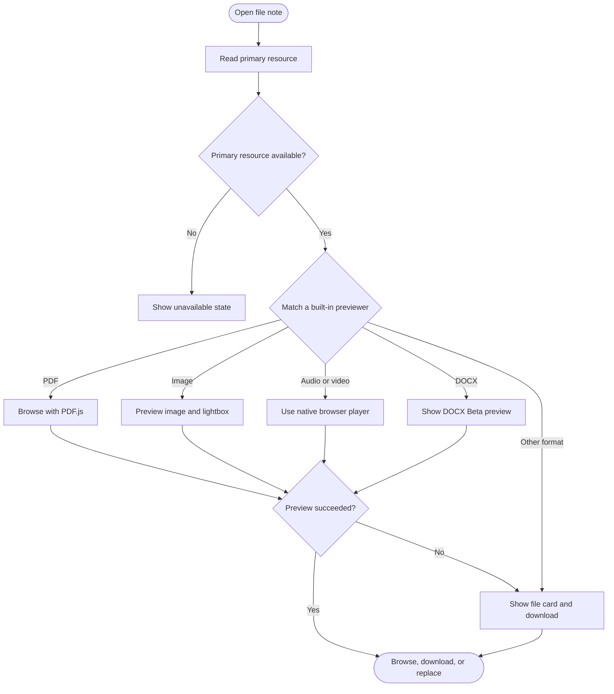

# File Note Preview and Rename Iteration

## Goal

This iteration completes the core file-note reading and management experience: attachment management shows the real source note, file notes reuse the existing PDF, image, audio, video, and DOCX preview capabilities, and synced files can be renamed without changing their extension.

## Verified Facts

- PDF, image lightbox, audio, video, and DOCX preview components already exist. DOCX is best-effort rendering and remains Beta.
- `PATCH /api/v1/resources/:id` already changes resource filenames without moving or uploading the OSS object again.
- Attachment management returns the local resource mirror first, while per-note resource refreshes currently write empty `memoTitle` and `memoExcerpt` values. A new file can therefore appear as an unnamed source note.

## Scope

- Preserve source-note titles and excerpts in the resource mirror. Online attachment management refreshes authoritative server metadata while retaining pending local uploads.
- Add a previewer registry selected by resource MIME type and extension.
- Connect PDF, image, audio, video, and DOCX Beta previews to file notes. Other formats keep download and replacement actions.
- Add rename entry points to file notes and attachment management. The UI edits only the stem and preserves the original extension.
- Keep filename and note title as independent fields. This iteration does not overwrite the note title when a file is renamed.

## File Open Flow

Solid arrows show UI control progression, not resource data transfer.

## Rename Rules

- `report.pdf` can become `2026 report.pdf`; rename cannot turn it into `.docx`.
- Changing the file type requires Replace File.
- Rename updates file metadata and the download name without copying, moving, or uploading object bytes.
- Unsynced local resources, read-only notes, and deleted notes do not expose rename.

## Acceptance

- A newly uploaded PDF immediately shows its source-note title in attachment management.
- PDF, image, audio, video, and DOCX files up to 10 MiB use their registered file-note preview. Download remains available after preview failure.
- File-note, attachment-manager, and download filenames agree after rename, with the extension unchanged.
- Unregistered formats such as XLSX and PPTX remain downloadable and are not presented as previewable.

## Out of Scope

- Do not add ONLYOFFICE, Collabora, or a commercial document SDK.
- Do not add Office editing or improve DOCX rendering fidelity.
- Do not bind file rename to note-title changes automatically.
