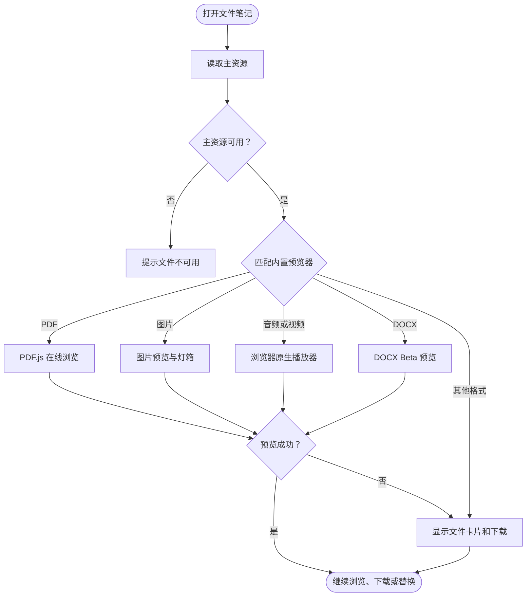

# 文件笔记预览与重命名迭代

## 目标

本迭代补齐文件笔记的读取和管理体验：附件管理显示真实来源笔记；文件笔记复用现有 PDF、图片、音频、视频和 DOCX 预览能力；已同步文件可以重命名且扩展名保持不变。

## 已核验事实

- PDF、图片灯箱、音频、视频和 DOCX 预览组件已经存在；DOCX 仅为尽力渲染，标记为 Beta。
- `PATCH /api/v1/resources/:id` 已支持修改资源文件名，不需要移动或重新上传 OSS 对象。
- 附件管理先返回本地资源镜像，而单篇笔记资源刷新会把 `memoTitle` 和 `memoExcerpt` 写成空值，因此新文件可能显示“未命名笔记”。

## 范围

- 修复资源镜像中的来源笔记标题和摘要；在线附件管理先刷新服务端权威元数据，同时保留本地待同步上传。
- 建立按资源 MIME/扩展名匹配的预览器注册表。
- 文件笔记接入 PDF、图片、音频、视频和 DOCX Beta；其他格式保留下载和替换。
- 文件笔记与附件管理提供重命名入口；界面只编辑主文件名，保留原扩展名。
- 文件名和笔记标题保持两个独立字段；本轮重命名不自动覆盖笔记标题。

## 打开文件流程

图中实线箭头表示页面控制推进，不表示资源数据的传输方向。

## 重命名规则

- `报告.pdf` 可改为 `2026 年报告.pdf`，不可通过重命名改成 `.docx`。
- 改变文件类型必须使用“替换文件”。
- 重命名更新文件元数据和下载名，不复制、移动或重新上传对象数据。
- 未同步的本地临时资源、只读笔记和已删除笔记不开放重命名。

## 验收

- 新上传 PDF 在附件管理中立即显示来源笔记标题。
- PDF、图片、音频、视频和不超过 10 MiB 的 DOCX 在文件笔记中进入对应预览；失败时仍可下载。
- 重命名后文件笔记、附件管理和下载名一致，扩展名未改变。
- XLSX、PPTX 等未注册格式仍能下载，不宣称支持在线预览。

## 非本轮范围

- 不引入 ONLYOFFICE、Collabora 或商业文档 SDK。
- 不支持 Office 在线编辑，也不提高 DOCX 渲染保真度。
- 不把文件重命名与笔记标题自动绑定。
