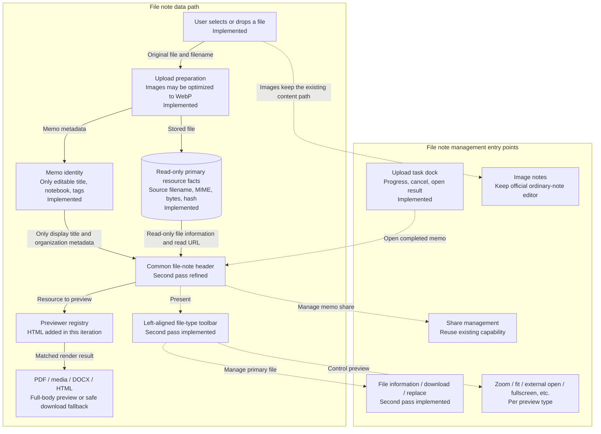

# File Note Shell and Safe Preview Iteration

## Goal

Complete the file-note experience added by the Larry fork without modifying the upstream editors for ordinary notes, mind maps, flowcharts, architecture diagrams, infographics, posters, or structured tables. File notes receive their own shell for memo metadata and file actions, previews use the full content area, static HTML gains a safe preview, and image notes created through the Upload file path retain the original uploaded filename and extension. The second UI pass keeps one editable note title, demotes the source filename to read-only file information, and gives file notes the same left-aligned toolbar hierarchy as the official diagram editors.

## Verified Facts

- The upstream `tianma-if/edgeever` `v2.28.2` baseline does not contain `FileDocumentPane`; file notes are a Larry fork capability.
- Upstream note types intentionally use different headers. They reuse smaller title, metadata, button, and menu components rather than one complete page shell.
- File selection, drag-and-drop creation, the bottom-right upload task dock, progress, cancellation, continued workspace use, and an explicit interrupted-upload memo instead of a blank memo are already implemented.
- Before the second pass, PDF, image, audio, video, and DOCX preview with a Beta badge were implemented, as were download, replacement, and rename.
- Image compression currently converts PNG, JPEG, WebP, or AVIF to WebP when the result is smaller and changes the uploaded filename to `.webp`.
- The server deliberately keeps HTML attachments as `Content-Disposition: attachment`; this iteration must not make HTML directly inline to enable preview.
- The first file shell exposed both an editable memo title and a renameable resource filename; they update separate memo and resource records and can therefore diverge.
- PDF reuses the complete `PdfViewer` designed for embedded ordinary-note attachments, so the file shell and the PDF toolbar repeat the same resource name.

## Confirmed Boundary

### Changed in this iteration

- Add a file-note-specific header and compact file toolbar.
- Allow memo title editing, notebook moves, tag editing, and access to existing share management.
- Expose only the memo title as the user-editable name; retain the primary filename as read-only source-file information.
- Use a left-aligned second-row file-type toolbar like the mind-map and flowchart editors: file information, download, replace, and relevant preview controls.
- Hide duplicate PDF names and file operations in file-note mode while leaving embedded ordinary-note PDFs unchanged.
- Keep best-effort DOCX preview without a Beta badge.
- Remove the duplicate large file-information card and let the preview use all remaining body space.
- Add constrained static HTML preview.
- For images uploaded through the Larry fork Upload file or drop-to-create path, retain the original filename and extension in the list and image alternative text while still allowing WebP storage optimization.

### Not changed in this iteration

- Do not modify `EditorPane`, `DiagramEditorPane`, `InfographicEditorPane`, `PosterEditorPane`, or `TableEditorPane`.
- Image uploads that become ordinary image notes continue using the official `EditorPane` and ordinary-note toolbar rather than the file-note shell.
- Do not create a global `NoteChrome` that all note types must adopt.
- Do not change image paste, insert, or compression behavior inside the ordinary note editor.
- Do not rewrite the displayed type of existing images; their lost original extension cannot be recovered reliably.
- Do not add Office editing, D2 preview/editing, XLSX/PPTX preview, or an external document SDK.
- Do not add automatic resume after a browser refresh or close. The existing upload dock and interrupted memo remain the v1 recovery boundary.
- Do not turn public file-note shares into full online preview pages; reuse the existing share management and attachment access behavior only.
- Do not remove resource `filename`, the resource rename API, or rename support in attachment management; remove rename only from the primary file-note UI.

## Relationship Overview

This diagram answers how one editable title and read-only source-file information reach the file-note page and which capabilities the toolbar manages. Legend: solid lines carry core data or rendered results; dashed lines show tool use or management relationships. Node text records the state after both implementation passes.

## Page and Interaction Design

### File note header

The first row contains memo-level information:

- Editable memo title.
- Current notebook and move control.
- Tag editing.
- Share entry.
- Mobile back action.
- Saving, failure, or read-only feedback when applicable.

The second row is a left-aligned file-type toolbar:

- Common actions are file information, download original, and replace file.
- A read-only information dialog shows the source filename, type, size, update time, and hash.
- PDF appends zoom, fit-width, external-open, and fullscreen controls after a divider; other types retain their native controls inside the preview body.
- DOCX does not display a Beta marker.
- Unsupported formats show a download explanation without a second large file card.

### Single editable name rules

- Editing the top title updates only the memo title.
- The primary resource `filename` is not editable from the file-note page; it remains a source-file fact.
- Moving the notebook moves only the memo.
- Editing tags updates only memo tags.
- Replacing the file updates source filename, MIME type, size, and hash without automatically changing the memo title.
- Replacement keeps the existing SHA-256 conflict guard; title changes must not bypass file conflict checks.

### Save and refresh behavior

- Title and tag updates use the existing memo edit session, `expectedRevision`, and `expectedContentHash`.
- Metadata updates preserve the file marker, legacy attachment link, and primary-resource relationship unchanged.
- Revision conflicts must not overwrite silently; show a non-blocking save-error state in the header while retaining the page and local input for retry.
- Notebook moves use the existing `moveMemos` operation.
- Success refreshes the current detail, memo lists, notebook counts, and attachment source metadata.

## Preview Layout

- `FileDocumentPane` uses a vertical flex layout; the header and toolbar remain fixed while the body is `min-h-0 flex-1`.
- Add a file-note-specific preview layout mode so ordinary-note embedded attachment sizes remain unchanged.
- PDF and DOCX scroll inside the body; images and video use `object-contain` and never stretch.
- Audio retains a compact player while its body area still fills the remaining page.
- PDF zoom, fit-width, external-open, and fullscreen controls live in the second row; PDF no longer repeats filename, type, download, or collapse inside the preview.
- Preview failure or an unsupported type always retains download access.

## Safe HTML Preview

### Supported scope

- Match `.html`, `.htm`, or `text/html`.
- The first version supports UTF-8 static HTML up to 5 MiB.
- Allow inline CSS and `data:` image, media, and font resources.
- Do not resolve sibling relative assets, load external network resources, or execute scripts.

### Security rules

- Fetch text through the authenticated resource API, then place it in a constrained `iframe srcdoc`.
- Do not grant `allow-scripts`, `allow-same-origin`, `allow-forms`, popups, or top-navigation permissions.
- Inject a CSP that constrains resource sources; scripts, forms, external network access, parent-page access, and credentials remain unavailable.
- Keep server-side HTML responses as attachments and preserve all existing resource security headers.
- Size, decoding, or rendering failure falls back to download without relaxing the sandbox.

## Original Uploaded Image Type

- Change only the Larry fork single-file upload/drop-to-create path.
- The stored image may still be converted to WebP by the existing compressor.
- Use the pre-compression filename as the image alternative text and memo-list excerpt source.
- New `photo.png`, `scan.jpg`, and `cover.webp` uploads retain `.png`, `.jpg`, and `.webp` in their displayed source name.
- Existing notes and images pasted/inserted in the ordinary editor remain unchanged.

## Implementation Order

1. Commit this plan as the pre-development checkpoint.
2. Preserve the original image filename through the single-file upload path and add tests.
3. Add the dedicated file note header and connect title, notebook, tags, and share.
4. Move existing download, rename, and replace controls into the compact toolbar.
5. Add the full-body file-note layout mode and adapt each previewer in that mode.
6. Register and implement the safe static HTML preview.
7. Run focused tests, type checks, and the Web build; do not push or deploy before verification.

### Second-pass UI refinement

1. Update this plan and relationship diagram and commit a pre-development checkpoint.
2. Remove resource rename from the file-note UI and add a read-only file-information dialog.
3. Move file actions into a left-aligned toolbar and share its container across non-PDF preview types.
4. Add a default-compatible file-note mode to `PdfViewer`, reusing its controls while hiding duplicate names and operations.
5. Remove the DOCX Beta marker while leaving image notes and embedded ordinary-note attachments unchanged.
6. Run focused tests, Web and mobile type checks, and the Web build; do not push or deploy before verification.

## Acceptance

### File shell

- A file note can edit its title, notebook, and tags and can open existing share management.
- The page exposes one editable memo title; the source filename appears only as read-only file information.
- Download and replace continue to work; file notes no longer expose rename, and replacement retains hash-conflict protection.
- Desktop and mobile headers do not overflow, and upstream note editors have no code changes.

### Preview

- PDF, audio, video, and DOCX use the file note body instead of an outer small-window width.
- PDF no longer repeats the resource name, type, or download action; embedded ordinary-note PDFs remain unchanged.
- DOCX does not display a Beta badge.
- Embedded attachment sizes in ordinary notes remain unchanged.
- Scripts, forms, popups, top navigation, and external network access do not work in HTML preview; static content and inline styles remain readable.
- Files over 5 MiB, non-UTF-8 content, parse failures, and unsupported types remain downloadable.

### Upload and list

- New PNG/JPG/WebP image notes created through Upload file or drag-and-drop display the original extension.
- Existing upload progress, cancellation, workspace navigation, open-on-completion, and interrupted-upload explanation continue to work.
- Refresh does not promise automatic resume, but it must not reintroduce a title-only blank memo.
- Attachment management continues to show the correct source memo title.
- Image notes continue using the official ordinary-note header and editor toolbar.

### Engineering verification

- Focused file-note, upload, resource-rename, and HTML-sandbox tests pass.
- `bun run typecheck`
- `bun run typecheck:mobile`
- `bun run build:web`
- Run the complete non-E2E suite before release. Record unverified platforms and real production behavior rather than claiming success in advance.

## Risks and Rollback

- Worst cases are incorrect memo metadata saves, lost file actions, an overly permissive HTML sandbox, or accidental size changes to shared attachment previews.
- Limit the blast radius with file-note-specific components, a dedicated layout mode, a strict HTML sandbox, and focused security tests.
- This iteration has no database migration. Rollback can remove the file shell, HTML previewer, and original-filename propagation while preserving the existing memo, primary resource, upload task, download, replace, and rename protocols.

## Post-implementation Record

This section records only outcomes that actually occurred; it does not represent an unperformed push or deployment as successful.

- Pre-development documentation checkpoint: `afc2b0e6` (`docs: plan file note shell and safe preview`).
- Implementation commit: `d3382906` (`feat: improve file note shell and previews`).
- Second-pass pre-development documentation checkpoint: `1d65332b` (`docs: plan single-name file note toolbar`).
- Second-pass implementation commit: `7402fb48` (`feat: refine file note toolbar`).
- Focused tests: 15 passed and 0 failed; shared locale-catalog tests: 24 passed and 0 failed.
- Static and build verification: `bun run lint`, `bun run typecheck`, `bun run typecheck:mobile`, and `bun run build:web` all passed.
- Complete non-E2E verification: 5,906 bulk tests passed and 0 failed; 41 integration tests passed, 1 Windows-only test was skipped on macOS, and 0 failed.
- Second-pass focused verification: 16 file-note and preview tests passed and 0 failed; 21 locale-catalog tests passed and 0 failed.
- Second-pass static and build verification: `bun run lint`, `bun run typecheck`, `bun run typecheck:mobile`, and `bun run build:web` all passed.
- Second-pass complete non-E2E verification: 5,907 bulk tests passed and 0 failed; 41 integration tests passed, 1 Windows-only test was skipped on macOS, and 0 failed.
- Push and deployment: `main` was pushed; Yunxiao pipeline `#14` deployed commit `0a12ec8c` at 2026-11-19 12:55 CST, with both build and deployment reporting `SUCCESS`.
- Post-deployment readback: `/api/health` returned `ok: true` with migration `0098`; the local CLI and Claude Code Skill both report `0.8.2`.
- Second-pass push and deployment: not performed.
- Unverified: manual desktop/mobile browser interaction, the production HTML-file preview flow, E2E, and production-data content regression.
