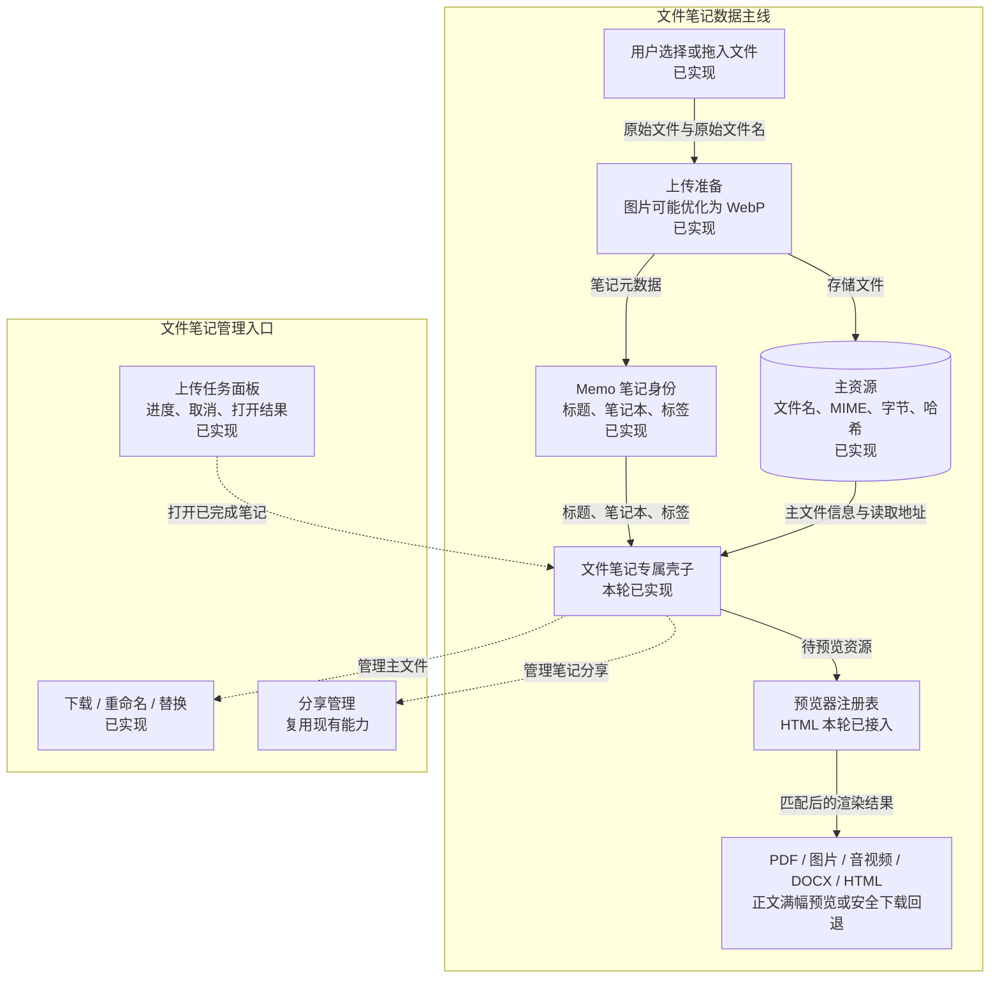

# 文件笔记壳子与安全预览迭代

## 目标

在不修改上游普通笔记、思维导图、流程图、架构图、信息图、海报和多维表格编辑器的前提下，完善 Larry Fork 新增的文件笔记：使用文件笔记专属壳子管理笔记元数据和文件操作，让预览占满正文区域，增加安全静态 HTML 预览，并让通过“上传文件”入口创建的图片笔记保留原上传文件名和扩展名。

## 已核验事实

- 上游 `tianma-if/edgeever` 的 `v2.28.2` 基线没有 `FileDocumentPane`；文件笔记是 Larry Fork 新增能力。
- 上游不同笔记类型本来就使用不同头部。它们复用标题、元数据、按钮和菜单等小组件，而不是共用一个完整页面壳子。
- 当前已支持上传文件入口、拖拽创建、右下角上传任务、进度、取消、切换笔记继续使用，以及中断后保留明确说明而非空白笔记。
- 当前已支持 PDF、图片、音频、视频和 DOCX Beta 预览，以及文件下载、替换和重命名。
- 当前图片压缩会在输出更小时把 PNG、JPEG、WebP 或 AVIF 实际转为 WebP，并将上传文件名改为 `.webp`。
- 服务端刻意对 HTML 附件保持 `Content-Disposition: attachment`；本迭代不得为了预览把 HTML 改为直接内联响应。

## 已确认边界

### 本轮修改

- 为文件笔记增加专属头部和紧凑文件工具行。
- 支持编辑笔记标题、移动笔记本、编辑标签和打开现有分享管理。
- 保持笔记标题与主文件名相互独立。
- 去掉重复的大文件信息卡，让预览正文使用全部剩余空间。
- 增加受限静态 HTML 预览。
- 通过 Larry Fork 的“上传文件”或拖拽创建入口上传图片时，列表和图片替代文本保留原始文件名与扩展名；存储文件仍可优化为 WebP。

### 本轮不修改

- 不修改 `EditorPane`、`DiagramEditorPane`、`InfographicEditorPane`、`PosterEditorPane` 和 `TableEditorPane`。
- 不建立要求所有笔记类型接入的全局 `NoteChrome`。
- 不改变普通笔记编辑器中的图片粘贴、插入和压缩行为。
- 不修改已上传旧图片的显示类型；无法可靠恢复已经丢失的原始扩展名。
- 不实现 Office 编辑、D2 预览/编辑、XLSX/PPTX 预览或外部文档 SDK。
- 不实现刷新或关闭浏览器后的自动断点续传。现有上传任务面板和中断笔记继续作为 v1 恢复边界。
- 不把文件分享页升级为完整在线预览页；本轮只复用现有分享管理和附件访问行为。

## 关系概览

本图回答“文件如何形成可管理的文件笔记，以及专属壳子使用哪些既有能力”。图例：实线表示核心数据或渲染结果传递，虚线表示工具使用或管理关系。节点文字记录本轮完成后的实现状态。

## 页面与交互设计

### 文件笔记头部

第一行是笔记级信息：

- 可编辑笔记标题。
- 当前笔记本和移动入口。
- 标签编辑。
- 分享入口。
- 移动端返回。
- 保存中、保存失败或只读提示。

第二行是紧凑文件工具行：

- 左侧显示实际文件名、类型和大小。
- 右侧显示下载、重命名和替换。
- DOCX 等尽力预览保留 Beta 标记。
- 不支持预览的格式显示下载说明，但不再重复显示一张大文件卡。

### 独立名称规则

- 修改顶部标题只更新 memo 标题。
- 重命名文件只更新主资源 `filename`，扩展名继续由现有规则保护。
- 移动笔记本只移动 memo。
- 修改标签只更新 memo 标签。
- 替换文件继续使用现有 SHA-256 冲突保护；不得因标题变更绕过文件冲突检查。

### 保存与刷新

- 标题和标签更新使用现有 memo edit session、`expectedRevision` 和 `expectedContentHash`。
- 更新元数据时原样保留文件标记、旧客户端附件链接和主资源关系。
- revision 冲突不得静默覆盖；在头部显示非阻塞保存失败状态，保留当前页面和本地输入供用户重试。
- 笔记本移动使用现有 `moveMemos`。
- 成功后同步当前详情、笔记列表、笔记本计数和附件管理来源信息。

## 预览布局

- `FileDocumentPane` 使用纵向 `flex`；头部和工具行固定，正文 `min-h-0 flex-1`。
- 增加文件笔记专用预览布局模式，避免改变普通笔记内嵌附件的现有尺寸。
- PDF 和 DOCX 在正文内部滚动；图片和视频使用 `object-contain`，不得拉伸变形。
- 音频保留紧凑播放器，但其所在正文区域仍占满剩余空间。
- PDF 内部保留页码、缩放、旋转和全屏等预览专属控制；通用文件名和文件操作只在文件工具行显示。
- 预览失败或类型不支持时始终保留下载入口。

## HTML 安全预览

### 支持范围

- 匹配 `.html`、`.htm` 或 `text/html`。
- 第一版只支持不超过 5 MiB 的 UTF-8 静态 HTML。
- 允许内联 CSS，以及 `data:` 图片、音视频和字体资源。
- 不解析文件夹中的相对资源，不加载外部网络资源，不运行脚本。

### 安全规则

- 客户端通过认证资源接口读取文本，再放入受限 `iframe srcdoc`。
- iframe 不设置 `allow-scripts`、`allow-same-origin`、`allow-forms`、弹窗或顶层导航权限。
- 注入限制资源来源的 CSP；脚本、表单、外部网络、父页面访问和登录凭据不可用。
- 服务端 HTML 响应继续保持附件下载，不修改现有资源安全头。
- 超限、解码失败或渲染失败时回退到文件下载，不放宽沙箱。

## 图片原上传类型

- 只修改 Larry Fork 的单文件上传/拖拽创建链路。
- 图片实际存储仍可经现有压缩器转为 WebP。
- 生成图片笔记正文时使用上传前的原始文件名作为图片替代文本和列表摘要来源。
- 新上传的 `photo.png`、`scan.jpg`、`cover.webp` 分别保留 `.png`、`.jpg`、`.webp` 显示。
- 旧笔记和普通编辑器内粘贴/插入图片保持原状。

## 实施顺序

1. 先提交本方案文档，形成开发前检查点。
2. 修复单文件图片上传链路的原始文件名传递并补测试。
3. 增加文件笔记专属头部，接通标题、笔记本、标签和分享。
4. 将现有下载、重命名、替换整合到紧凑工具行。
5. 增加文件笔记专用满幅布局，调整各预览器的文件页模式。
6. 注册并实现安全静态 HTML 预览。
7. 运行定向测试、类型检查和 Web 构建；不在验证前推送或部署。

## 验收

### 文件壳子

- 文件笔记能修改标题、笔记本和标签，并能打开现有分享管理。
- 笔记标题和文件名相互独立。
- 下载、重命名和替换继续工作；替换继续执行哈希冲突保护。
- 桌面和移动端头部不溢出，官方其他笔记编辑器没有代码变化。

### 预览

- PDF、图片、音频、视频和 DOCX 使用文件笔记正文区域，不再受外层小窗口宽度限制。
- 普通笔记内的附件预览尺寸不变。
- HTML 中脚本、表单、弹窗、顶层导航和外部网络均不可用；静态内容和内联样式可读。
- 超过 5 MiB、非 UTF-8、解析失败或不支持的文件继续可以下载。

### 上传与列表

- 通过“上传文件”或拖拽创建的新 PNG/JPG/WebP 图片笔记显示原始扩展名。
- 现有上传任务进度、取消、切换笔记、完成后打开和中断说明继续工作。
- 页面刷新不承诺自动续传，但不得重新出现只有标题的空白笔记。
- 附件管理继续显示正确来源笔记标题。

### 工程验证

- 文件笔记、上传、资源重命名和 HTML 沙箱定向测试通过。
- `bun run typecheck`
- `bun run typecheck:mobile`
- `bun run build:web`
- 完整非 E2E 测试在发布前执行；本地未验证的平台和真实生产行为必须记录，不提前填写成功结论。

## 风险与回滚

- 最坏后果是文件笔记元数据保存错误、文件操作入口失效、HTML 沙箱过宽或共享预览组件尺寸被意外改变。
- 通过文件笔记专属组件、专用布局模式、严格 HTML 沙箱和定向安全测试限制影响范围。
- 本轮没有数据库迁移。回滚可撤销文件笔记壳子、HTML 预览器和原始文件名传递；现有 memo、主资源、上传任务、下载、替换和重命名数据协议不变。

## 实施后记录

本节只记录已经实际发生的结果，不把未执行的推送或部署写成成功。

- 开发前文档检查点：`afc2b0e6`（`docs: plan file note shell and safe preview`）。
- 实现提交：`d3382906`（`feat: improve file note shell and previews`）。
- 定向测试：15 项通过、0 失败；共享多语言目录测试 24 项通过、0 失败。
- 静态与构建验证：`bun run lint`、`bun run typecheck`、`bun run typecheck:mobile`、`bun run build:web` 全部通过。
- 完整非 E2E 验证：批量测试 5906 项通过、0 失败；集成测试 41 项通过、1 项 Windows 专用测试在 macOS 跳过、0 失败。
- 未验证项：真实浏览器桌面/移动端人工交互、生产服务器上的 HTML 资源行为、E2E 和生产数据回归。
- 推送与部署：未执行。
