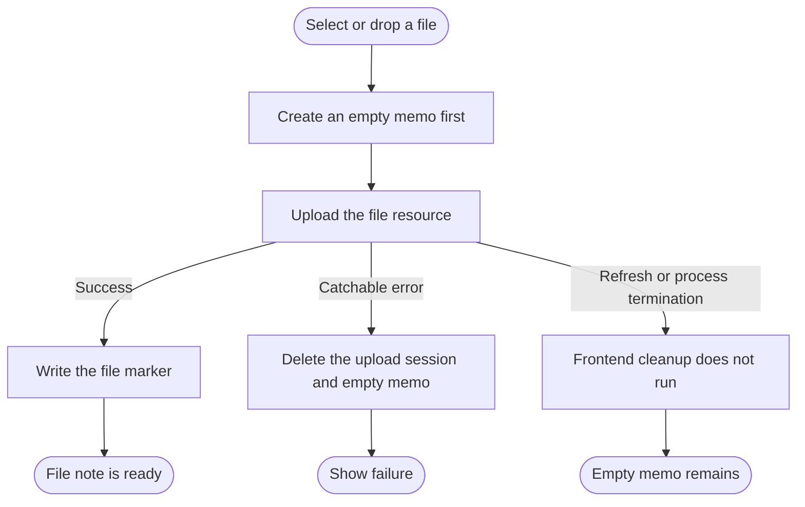
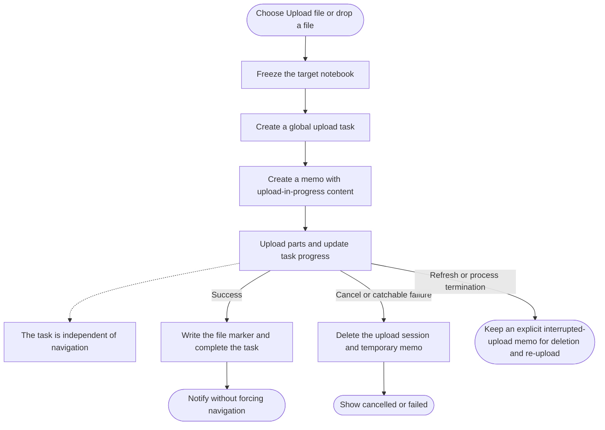

# Reliable File Note Upload v1

## Goal

Let users upload Word, PDF, D2, and other files from the New note menu or by drag and drop while continuing to use the workspace. An interrupted upload must not leave a normal-looking empty note.

## In Scope

- Add **Upload file** to the desktop sidebar and mobile create menus.
- Route menu uploads and drag-and-drop uploads through the same file-note flow.
- Show upload tasks, file size, state, part progress, cancel, and dismiss actions in a workspace-level dock.
- Keep uploads independent from the currently viewed note. Completion notifies the user without forcing navigation.
- Seed the pre-upload memo with explicit bilingual upload-in-progress content. A refresh or terminated process therefore leaves a recognizable interrupted memo rather than an empty one.
- Preserve the existing cleanup of the temporary memo and upload session for cancellation and catchable failures.

## Out of Scope

- Automatic continuation after a browser refresh or close.
- Cross-device handoff, folder upload, or a multi-file queue.
- Moving editor images, posters, structured tables, or other upload paths into the dock.
- Online preview or editing for Word, PDF, or D2 files.

## Current Failure

Arrows represent control progression.

## v1 Flow

Solid arrows represent control progression. The dashed edge is explanatory only.

## States and Recovery

| State | User sees | Available action |
| --- | --- | --- |
| Preparing | File name and size | Cancel |
| Uploading | Uploaded bytes and progress | Cancel; keep using the workspace |
| Completed | Completion state | Open note; dismiss task |
| Failed | Failure state | Dismiss and upload again |
| Cancelled | Cancelled state | Dismiss task |

A refresh destroys in-memory browser tasks, so v1 does not claim automatic resume. Cross-refresh upload-session recovery is a separate v2. v1 removes silent empty data by leaving a recognizable temporary memo.

## Acceptance

1. Both desktop and mobile create menus can select and upload one file.
2. Dragging a file still creates a file note.
3. Users can switch, read, and edit other notes during an upload.
4. Completion does not steal navigation; the task dock can explicitly open the result.
5. Cancel aborts the request and cleans up the temporary memo.
6. Refreshing during upload never leaves a title-only empty memo; the interrupted memo explicitly says the upload is incomplete.
7. Markdown import, existing file-note download and replacement, and desktop share imports keep their existing behavior.
8. Web typecheck, Web build, client upload tests, and focused file-note tests pass.

## Risk and Rollback

- Progress updates when server parts complete. A 7 MiB file can still be a single 8 MiB part, so v1 may move from 0 to 100 percent; the task remains visible and cancellable throughout.
- Rollback can remove the menu, dock, and callbacks. The temporary memo is ordinary Markdown readable by older versions and requires no database migration.
