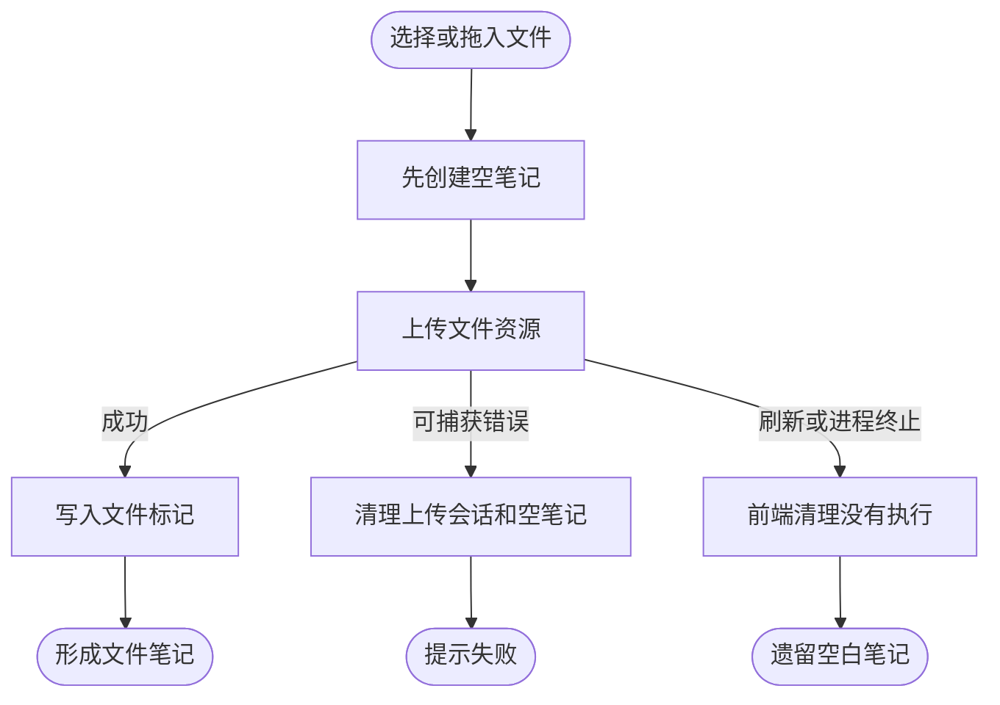
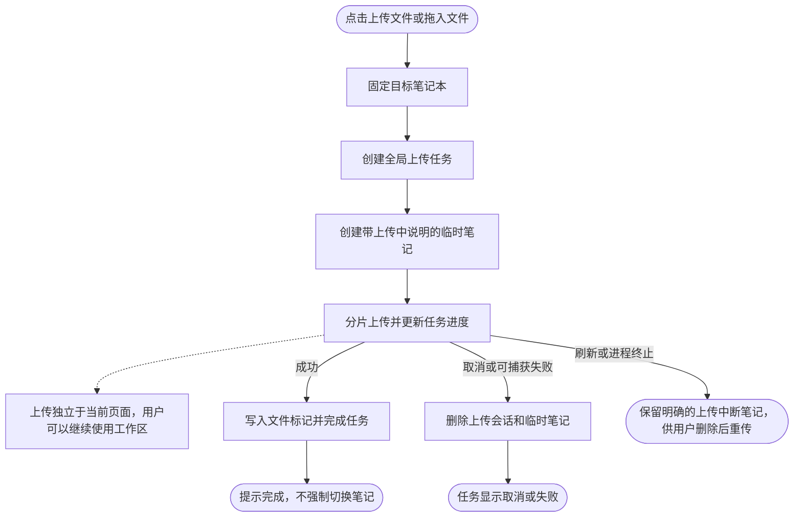

# 文件笔记可靠上传 v1 迭代

## 目标

让用户从“新建笔记”菜单或拖拽入口上传 Word、PDF、D2 等文件，并在上传期间继续使用工作区。上传中断时不得遗留看似正常的空白笔记。

## 本轮范围

- 桌面侧栏和移动端新建菜单增加“上传文件”。
- 菜单上传与拖拽上传复用同一条文件笔记创建链路。
- 工作区右下角显示上传任务、文件大小、状态、分片进度，并支持取消和移除任务。
- 上传任务不跟随当前笔记切换；上传完成后只提示，不强制打开新笔记。
- 文件上传前创建的笔记写入明确的双语“上传中”内容。页面刷新或进程中断时，用户看到的是可识别、可删除后重传的中断笔记，不是空白笔记。
- 上传取消或可捕获失败时，继续沿用现有清理逻辑删除临时笔记和上传会话。

## 不在本轮

- 浏览器刷新、关闭后自动继续上传。
- 跨设备接力、文件夹上传和多文件队列。
- 把编辑器图片、海报、多维表格等其他上传入口统一到任务面板。
- Word、PDF、D2 在线预览或编辑。

## 当前缺陷

箭头表示控制推进。

## v1 流程

实线箭头表示控制推进，虚线只表示说明关系。

## 状态和恢复

| 状态 | 用户看到 | 允许操作 |
| --- | --- | --- |
| 准备中 | 文件名和大小 | 取消 |
| 上传中 | 已上传字节和进度 | 取消、继续使用工作区 |
| 已完成 | 完成状态 | 打开笔记、移除任务 |
| 失败 | 失败状态 | 移除后重新上传 |
| 已取消 | 取消状态 | 移除任务 |

刷新会销毁浏览器内存中的任务，因此 v1 不宣称自动续传。服务端和前端的跨刷新会话恢复另立 v2；v1 通过可识别的临时笔记消除静默空白数据。

## 验收

1. 桌面和移动新建菜单均能选择一个文件上传。
2. 拖入文件仍能创建文件笔记。
3. 上传过程中可切换、阅读和编辑其他笔记。
4. 上传完成不抢占当前页面，任务面板可以主动打开结果。
5. 取消会终止请求并清理临时笔记。
6. 页面刷新后不得出现只有标题的空白笔记；中断笔记必须明确说明上传未完成。
7. Markdown 导入、既有文件笔记下载和替换、桌面共享导入保持原行为。
8. 通过 Web 类型检查、Web 构建、客户端上传测试和文件笔记定向测试。

## 风险和回滚

- 任务进度按服务端分片完成更新；7 MiB 文件仍可能只有一个 8 MiB 分片，因此 v1 的百分比会从 0 跳到 100，但用户能看到任务持续存在并可取消。
- 回滚时可移除上传菜单、任务面板和上传回调；临时笔记中的普通 Markdown 仍可由旧版本读取，不需要数据库迁移。
