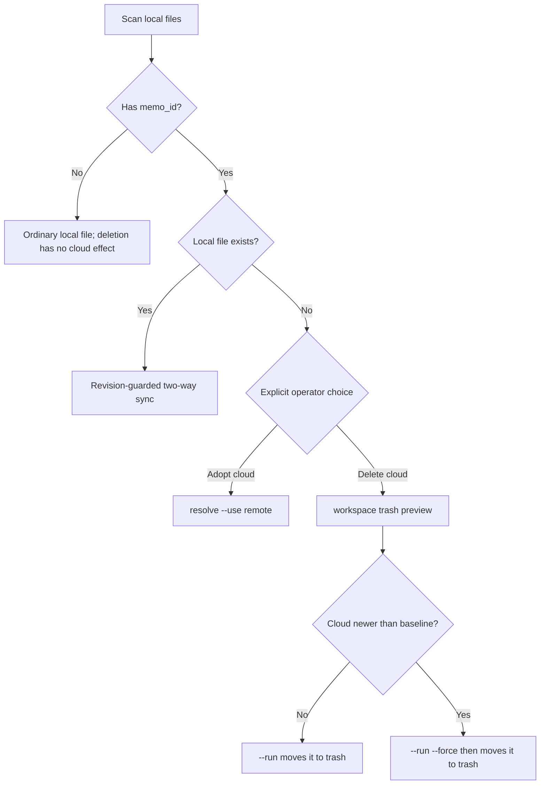

# MySystem Workspace Bootstrap, Recovery, and Trash Plan

## Goal and boundaries

EdgeEver is the complete cloud MySystem. A local directory is a controlled working copy for human or agent batch work, while Git provides local checkpoints. CLI 0.9.0 adds initial tree bootstrap, read-only diagnostics, new-machine adoption, and explicit trash operations on top of file-workspace protocol 1. It does not change the server, database, account isolation, or note model.

The local roots become the new cloud standard: `00_system`, `10_mind`, `20_info`, `30_daily`, `40_work`, `50_project`, `60_topic`, and `70_publish`. The current 134 Markdown files are in scope. Repository-level instructions, hidden tool directories, `99_temp`, and 71 D2 files are excluded. Existing cloud trees such as `1-Inbox`, `2-Daliy`, `3-Project`, `4-Area`, and `生活个人` remain unchanged and can later be reorganized with existing move operations.

## Operating model



- Never-imported files can be deleted locally without CLI state or cloud effects.
- A missing tracked file remains `missing-local`; ordinary sync never infers deletion.
- `workspace trash` uses the existing recoverable soft delete. Permanent deletion remains a Trash UI/API responsibility.
- A newer remote revision/hash blocks ordinary `--run`; `--force` is explicit authorization.
- When the CLI retires a still-present local file, it saves the source and receipt under `.edgeever/history/trash/`.
- Restoring the cloud memo later allows sync to materialize it locally again.

## CLI 0.9.0

### Initial bootstrap

```bash
# Preview only
edgeever --profile openbox workspace bootstrap /Users/larryguan/my-system \
  --include 00_system,10_mind,20_info,30_daily,40_work,50_project,60_topic,70_publish

# Apply explicitly
edgeever --profile openbox workspace bootstrap /Users/larryguan/my-system \
  --include 00_system,10_mind,20_info,30_daily,40_work,50_project,60_topic,70_publish \
  --run
```

`bootstrap` creates only directory paths containing Markdown, reuses a unique notebook at the same path, writes the real `memo_id` into successfully bound files, and hands attachments to the existing guarded sync path. Every applied run records progress under `.edgeever/bootstrap/`, while existing creation and upload journals provide operation-level recovery. Re-running does not duplicate tracked files.

Same-title notes are candidates only. An optional `--mapping <json>` can choose `bind`, `create`, or `skip` per path:

```json
{
  "version": 1,
  "items": {
    "50_project/example.md": { "action": "bind", "memoId": "memo_xxx" },
    "30_daily/2026/example.md": { "action": "create" },
    "10_mind/old.md": { "action": "skip" }
  }
}
```

Binding requires an active memo in the intended notebook with matching normalized content. An unresolved candidate skips only that file. Bootstrap never calls delete, moves legacy notes, imports D2, or rewrites inter-note links.

### Diagnostics

```bash
edgeever --profile openbox workspace doctor /Users/larryguan/my-system
```

`doctor` reads local and remote state and reports duplicate or invalid identity, missing local files, remote trash, remote changes, title/notebook drift, baseline integrity, relative attachments, inter-note links, and unsupported types. Exit codes are 0 for clean, 1 for command/authentication failure, and 2 for completed checks with actionable findings.

### New-machine adoption

```bash
edgeever --profile openbox workspace adopt /Users/larryguan/my-system
edgeever --profile openbox workspace adopt /Users/larryguan/my-system --run
```

`adopt` derives the workspace and root notebooks from embedded IDs. Equal bodies rebuild local state. Different bodies create an `adopt-conflict` without choosing either version; the existing `resolve --use local|remote|merge` workflow completes the decision. Adopt never creates, deletes, or edits cloud notes.

### Explicit trash

```bash
edgeever workspace trash ./my-system --memo memo_xxx
edgeever workspace trash ./my-system --memo memo_xxx --run
edgeever workspace trash ./my-system --memo memo_xxx --run --force
```

## Acceptance and rollout

Coverage must include zero-write preview, recursive creation and idempotent retry, interrupted operations, title candidates, two-phase attachment upload, duplicate IDs, new-clone adoption, remote trash, forced confirmation after remote changes, denied write scope, and all existing sync/conflict/GC regressions. Commit a `my-system` Git baseline before import, pilot one small directory, then import the eight roots in batches and commit the inserted IDs separately. No server deployment or migration is required for CLI 0.9.0.

## Verified record (2026-11-23)

The real-directory preview found 134 Markdown files and 63 required directories while excluding 71 D2 files, 23 hidden entries, and 3 other files. It classified 102 files as direct creates and left 32 same-title candidates for explicit mapping. Preview created no `.edgeever` state and performed no cloud writes. A full `--run` has not been executed.
