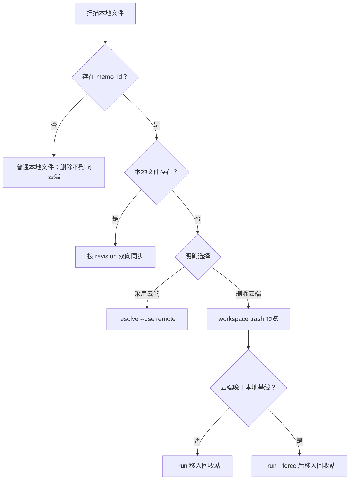

# MySystem 工作区批量接入、恢复与删除方案

## 目标与边界

EdgeEver 是云端完整 MySystem；本地目录是可由人或 Agent 批量加工的受控副本，Git 是本地版本检查点。CLI 0.9.0 在现有 file-workspace 协议 1 上增加首次批量接入、只读质检、新设备恢复和显式回收站操作，不修改服务端、数据库、账号隔离或笔记模型。

本次以本地目录为云端新标准树：`00_system`、`10_mind`、`20_info`、`30_daily`、`40_work`、`50_project`、`60_topic`、`70_publish`。当前盘点的 134 篇 Markdown 属于接入目标；根目录说明文件、隐藏工具目录、`99_temp` 和 71 个 D2 文件不接入。已有 `1-Inbox`、`2-Daliy`、`3-Project`、`4-Area`、`生活个人` 等云端树及内容保持不变，之后使用现有移动能力显式整理。

## 操作模型



- 从未接入云端的文件可以直接删除，CLI 不记录。
- 已绑定文件缺失时，普通同步只报告 `missing-local`。
- `workspace trash` 只调用现有软删除；永久删除仍在 EdgeEver 回收站完成。
- 云端 revision/hash 已变化时，普通 `--run` 停止；必须显式增加 `--force`。
- CLI 主动回收仍存在的本地文件时，原文和操作记录进入 `.edgeever/history/trash/`。
- 云端从 Web 恢复后，后续同步可重新物化本地文件。

## CLI 0.9.0

### 首次接入

```bash
# 默认预览，无本地或云端写入
edgeever --profile openbox workspace bootstrap /Users/larryguan/my-system \
  --include 00_system,10_mind,20_info,30_daily,40_work,50_project,60_topic,70_publish

# 明确执行
edgeever --profile openbox workspace bootstrap /Users/larryguan/my-system \
  --include 00_system,10_mind,20_info,30_daily,40_work,50_project,60_topic,70_publish \
  --run
```

`bootstrap` 只创建包含 Markdown 的目录层级，复用唯一同路径笔记本，向成功绑定的文件写入真实 `memo_id`，并用现有同步链路完成附件上传。每次执行在 `.edgeever/bootstrap/` 保存进度清单；笔记本创建、笔记创建和附件上传同时沿用已有日志恢复。中断后重跑不会重复绑定已跟踪文件。

同名笔记只报告候选，不自动绑定。可传入 `--mapping <json>`，格式如下：

```json
{
  "version": 1,
  "items": {
    "50_project/example.md": { "action": "bind", "memoId": "memo_xxx" },
    "30_daily/2026/example.md": { "action": "create" },
    "10_mind/old.md": { "action": "skip" }
  }
}
```

`bind` 只有在目标笔记存在、未删除、处于目标笔记本且正文一致时才成功。候选未决只跳过对应文件，不阻塞其他文件。`bootstrap` 不调用删除接口、不移动旧笔记、不导入 D2，也不改写笔记间链接。

### 质检

```bash
edgeever --profile openbox workspace doctor /Users/larryguan/my-system
```

`doctor` 只读检查身份重复、非法元数据、本地缺失、云端回收站、远端变化、标题/笔记本漂移、基线、相对附件、笔记间链接和不支持类型。无问题退出 0；命令失败退出 1；完成检查但存在待处理项退出 2。

### 新设备恢复

```bash
edgeever --profile openbox workspace adopt /Users/larryguan/my-system
edgeever --profile openbox workspace adopt /Users/larryguan/my-system --run
```

`adopt` 从 Markdown 内的 `memo_id` 推导工作区与根笔记本。正文一致时重建本地状态；正文不一致时创建 `adopt-conflict`，不覆盖任一版本，随后使用现有 `resolve --use local|remote|merge` 处理。它不创建、删除或修改云端笔记。

### 显式回收

```bash
edgeever workspace trash ./my-system --memo memo_xxx
edgeever workspace trash ./my-system --memo memo_xxx --run
edgeever workspace trash ./my-system --memo memo_xxx --run --force
```

## 验收与上线

必须覆盖预览零写入、递归创建与重跑幂等、中断恢复、同名候选、附件二阶段上传、重复 ID、新克隆 adopt、远端回收站、revision 变化强制确认、无写权限拒绝以及现有同步/冲突/GC 回归。先提交 `my-system` 接入前 Git 基线，再试点一个小目录；通过后分批接入八个正式目录，并把新增 `memo_id` 单独提交。服务端无改动，不因 CLI 0.9.0 重装或迁移服务器。

## 已核验记录（2026-11-23）

真实目录检查模式识别到 134 篇 Markdown、63 个必要目录，排除 71 个 D2、23 个隐藏项和 3 个其他文件。102 篇可直接创建；32 篇存在同名候选，保持待映射状态。检查模式没有创建 `.edgeever`，也没有执行云端写入。完整 `--run` 尚未执行。
