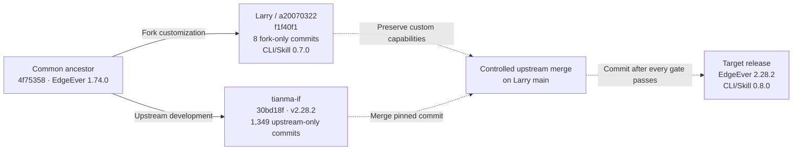
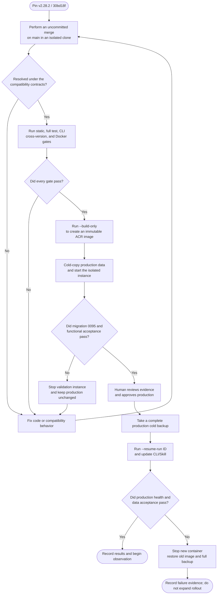

# EdgeEver v2.28.2 Upstream Upgrade Development Plan

> Status: planned, not implemented
> Prepared: 2026-11-17
> Current production baseline: `LarryGuan/edgeever@f1f40f16987eb4ba04cdcb6ed77184130c2b3112`
> Pinned upstream target: `tianma-if/edgeever@30bd18fdfa48118da265f849b974f9fbd2f0f46f` (`v2.28.2`)

## 1. Decision Summary

`LarryGuan/edgeever` remains the only production deployment source. This upgrade merges the pinned upstream `v2.28.2` into the existing customized fork while preserving the standalone CLI, Claude/Codex Skill, file-workspace protocol, attachment synchronization, edit-session protection, and atomic revision writes.

Production will not switch directly to `tianma-if/edgeever`, because upstream does not contain this fork's `cli/`, file-workspace implementation, or matching server extensions. Future synchronization will also bypass `a20070322/edgeever`, whose `main` currently matches Larry's `main` exactly.

This delivery covers only the Docker self-hosted Web/API and standalone CLI/Skill. Desktop, Android, iOS, Cloudflare, and official multi-platform releases are out of scope.

## 2. Status and Evidence Boundary

This document uses the following labels so planned work is not reported as completed work:

- **Verified**: obtained through read-only inspection of Git history, the current repository, or the production server.
- **Planned**: required during implementation but not yet executed.
- **Execution record**: filled only with actual commits, pipeline runs, images, backups, and verification results after execution.

### 2.1 Verified Facts

| Item | Current result |
| --- | --- |
| Common ancestor | `4f753587f66de8c150dd9a39660580457911a7a9` |
| Larry vs. a20070322 | both `main` refs are `f1f40f1`; commit difference `0/0` |
| Fork-only history | 8 commits: 6 feature/documentation commits and 2 upstream merge commits |
| Upstream-only history | 1,349 commits |
| Application version | `1.74.0` → `2.28.2` |
| Database migration | current `0050`; target `0095` |
| Files changed by the fork | 53 |
| Files also changed upstream | 7 |
| Simulated textual conflicts | 4: `memo-service.ts`, `resource-routes.ts`, `package.json`, `bun.lock` |
| Current production image | `registry.cn-hangzhou.aliyuncs.com/larryguan/edgeever_zzy:2026-09-20-13-59-23` |
| Current production data | about 6.9 MB under `/data/edgeever/data`; SQLite about 2.7 MB |
| Server headroom | about 9 GB disk, 4.2 GB available memory, 4 vCPU |

This capacity is sufficient for a short-lived isolated validation instance on the same server. Production and validation must never share a SQLite database or resource directory.

## 3. Code Lineage and Target

The diagram answers where the code diverged and what this merge is intended to produce. Solid arrows are verified history; dashed arrows are planned actions.



## 4. Compatibility Contracts to Preserve

The upgraded server must keep these contracts, with `protocolVersion` remaining `1`:

| Interface/behavior | Requirement | Primary check |
| --- | --- | --- |
| `GET /api/v1/file-workspace` | Return workspace identity plus atomic-revision and attachment-sync capabilities | The old CLI completes its capability probe |
| `POST /api/v1/memos/:id/edit-sessions` | Bind an edit session to a revision/content hash | A stale session cannot overwrite newer content |
| `GET /api/v1/memos/:id/resources` | Return only resources for that memo in the current workspace | Cross-workspace data remains inaccessible |
| `GET /api/v1/resources/:id` | Return resource metadata only in the current workspace | Unauthorized IDs are rejected or not found |
| Atomic revision writes | Abort the complete write batch when the read revision is stale | Return structured `409 revision_conflict`; never partially commit |
| Attachment synchronization | Keep body, metadata, and binary resources consistent | Download hashes, deletion, and conflict recovery remain correct |

The standalone CLI and Skill are planned to move from `0.7.0` to `0.8.0`, making EdgeEver `2.28.2` their explicit server compatibility baseline. Local workspace upgrades must preserve history, conflict drafts, directory bindings, and attachments; they must not silently rebuild a workspace.

## 5. Merge Implementation

### 5.1 Isolated Workspace and Pinned Baseline

Repository policy forbids new branches. Work therefore takes place in an independent clone on its checked-out `main`, with an uncommitted merge. The current production checkout remains untouched.

```bash
git clone https://github.com/LarryGuan/edgeever.git edgeever-upgrade-v2.28.2
cd edgeever-upgrade-v2.28.2
git checkout main
git remote add upstream https://github.com/tianma-if/edgeever.git
git fetch --no-tags upstream tag v2.28.2
test "$(git rev-list -n 1 v2.28.2)" = "30bd18fdfa48118da265f849b974f9fbd2f0f46f"
git merge --no-commit --no-ff 30bd18fdfa48118da265f849b974f9fbd2f0f46f
```

If the pinned commit check fails or a structural conflict appears outside this plan, run `git merge --abort` and stop. Do not substitute a moving `upstream/main` target.

### 5.2 Conflict Resolution

1. `apps/api/src/memo-service.ts`
   - Use the upstream `2.28.2` data model, transaction ordering, and new business behavior as the base.
   - Reintroduce the fork's compare-and-swap revision guard.
   - A stale revision must abort the entire batch and become `409 revision_conflict`; metadata, search index, audit, and content must never partially commit.

2. `apps/api/src/resource-routes.ts`
   - Preserve upstream pending-resource, publishing, and storage behavior.
   - Restore both read endpoints using upstream workspace authorization and mapping helpers.
   - Every query must constrain both `workspace_id` and the memo/resource ID.

3. `package.json`
   - Take the upstream `2.28.2` version, scripts, and dependency set.
   - Restore the root-workspace dependency `@lezer/markdown: 1.7.2`.
   - Move the standalone CLI/Skill to `0.8.0`; root application and CLI versions remain independent.

4. `bun.lock`
   - Never combine conflict blocks manually.
   - Regenerate with Bun `1.3.14` after resolving `package.json`; review dependency sources and unexpected large downgrades, then verify a frozen-lockfile install.

### 5.3 Semantic Review After Automatic Merges

- `memo-routes.ts`: capability probe and edit-session routes retain the correct scope checks.
- `mcp-tool-service.ts`: revision conflicts preserve the error code, HTTP status, and diagnostic message.
- `.github/workflows/sync-edgeever-upstream.yml`: unattended replacement of the customized fork remains disabled; all future upstream merges require review.
- `Dockerfile` and self-hosted entrypoint: custom CLI work does not change the image user, `/data` semantics, or health check.
- `knowledge-workbench-image.yml`: if retained, change its repository gate and image ownership to Larry. Do not claim CI ran while it is still gated to a20070322.

## 6. Build and Release Gate

### 6.1 New `--build-only` Mode

`auto/update.sh` is planned to gain an explicit mode:

```bash
./auto/update.sh --build-only
```

It must:

1. Safely synchronize Larry `main`, then run CLI install, test, and package preflight.
2. Start the Yunxiao pipeline and wait only for the image build.
3. Stop when the deployment job is `SWITCH_MANUAL`; never call the manual-deploy API.
4. Print a copyable `pipelineRunId`, immutable ACR image reference, and next command.
5. Leave the production container and local CLI/Skill unchanged.

Stable output fields should be:

```text
pipelineRunId=<id>
image=registry.cn-hangzhou.aliyuncs.com/larryguan/edgeever_zzy:<immutable-tag>
next=./auto/update.sh --resume-run <id>
```

`--build-only`, `--run`, `--resume-run`, and `--dry-run` must be mutually exclusive. A failed build, missing image artifact, or already-started deployment returns a nonzero status.

### 6.2 First Upgrade Release Rule

The all-in-one `--run` mode is prohibited for this cross-version upgrade. The required flow is:

```text
--build-only → isolated same-server validation → human approval → --resume-run ID
```

Whether routine releases may return to `--run` is decided only after the production observation period.

## 7. Verification Gates

### 7.1 Merge and Static Gates

```bash
rg -n '^(<<<<<<<|=======|>>>>>>>)' .
bun install
bun install --frozen-lockfile
bun run typecheck
bun run typecheck:mobile
bun run build:web
bun run test
bun x tsc -p tsconfig.file-workspace.json --noEmit
bun test scripts/file-workspace/core.test.mjs \
  apps/api/src/memo-routes.test.mjs \
  apps/api/src/resource-routes.test.mjs \
  apps/api/src/mcp-routes.test.mjs \
  apps/api/src/mcp-tools.test.mjs
npm ci --prefix cli --ignore-scripts --no-audit --no-fund
npm test --prefix cli
```

Acceptance requires no conflict markers, every command exiting zero, positive/authorization/conflict coverage for all four server contracts, and an explicit keep/upstream-replacement/removal disposition for each of the 53 fork-changed files.

### 7.2 Cross-Version CLI Verification

- Preserve an installable CLI `0.7.0` tgz and create a real old-workspace fixture containing directory bindings, attachments, history, and an unresolved conflict.
- Use CLI `0.8.0` to preview and then apply the workspace-state migration.
- Verify that the old CLI refuses the new state and that the new CLI preserves content, attachments, bindings, conflict drafts, and GC references.
- Test the packed tgz through an independent installation rather than running only from the source tree.

### 7.3 Docker Image Gate

```bash
docker build --platform linux/amd64 \
  --build-arg EDGE_EVER_BUILD_ID="$(git rev-parse HEAD)" \
  --tag edgeever-upgrade:v2.28.2-custom .
```

Use an empty data volume to verify first startup, migrations `0001 → 0095`, authentication, and `/api/health`. Empty-database verification is supplementary and does not replace production-data-copy validation.

## 8. Isolated Migration Validation on the Production Server

### 8.1 Boundary and Maintenance Window

- Reserve a ten-minute maintenance window. With the current 6.9 MB dataset, the cold copy is expected to be much shorter, but this estimate is not a guarantee.
- Production remains at `/data/edgeever`.
- Validation uses `/data/edgeever-upgrade-v2.28.2`.
- The validation Compose project is `edgeever-upgrade-v2282`.
- Validation listens only on `127.0.0.1:18787`; it receives no 1Panel/OpenResty public route.
- The two instances must not share SQLite, resources, a Compose project, or container names.

### 8.2 Cold-Copy Procedure

1. Record the production image, migration, health, and memo/notebook/resource counts.
2. Stop production EdgeEver and wait for graceful shutdown and the SQLite WAL checkpoint.
3. Save the complete `data/`, `compose.yaml`, `.env`, and `image.env` under a UTC-timestamped backup directory.
4. Create a separate validation data directory from the cold backup, preserving UID/GID `1000` and permissions.
5. Immediately restart the old production container and confirm public `/api/health`.
6. Start the isolated validation instance with the immutable image printed by `--build-only`.

### 8.3 Validation Acceptance

- `/api/health` reports `ok: true` and migration `0095`.
- Administrator login succeeds; workspace, notebook, memo, and resource counts match migration expectations.
- Sampled note bodies remain readable and attachment download hashes match.
- Web smoke coverage includes list, search, open, edit, create, attachment upload/download, delete, and restore.
- CLI `0.8.0` completes capability probe, pull, push, concurrent revision conflict, attachment sync, directory move, conflict draft, and GC scenarios.
- Logs show no repeated migration, SQLite lockup, permission error, or sustained 5xx response.

If isolated validation fails, stop that instance and retain its data copy, logs, and image. Production stays on the old release. Fixes return to the merge and gate stages; do not experiment against production data.

## 9. Production Approval and Rollback

### 9.1 Approval

1. Confirm that the isolated validation record is complete and explicitly approved by a person.
2. Confirm that old image `2026-09-20-13-59-23` remains available.
3. Take another complete cold production backup, including data, Compose, `.env`, and `image.env`.
4. Run `./auto/update.sh --resume-run <pipelineRunId>`.
5. Verify Yunxiao build/deploy `SUCCESS`, public health, migration `0095`, login, notes, and attachments.
6. Confirm local CLI and Claude Skill `0.8.0`, with `~/.agents/skills/edgeever` still linking to `~/.claude/skills/edgeever`.

### 9.2 Rollback

If the new container fails after migration:

1. Stop it to prevent further writes.
2. Preserve failing-container logs and a data copy; do not repair the original directory in place.
3. Restore the complete pre-upgrade `data/`, Compose, `.env`, and `image.env`.
4. Start the old image and verify health, login, and sampled data.

Never point the old image at a database already migrated to `0095`. Migrations have no automatic reverse path.

## 10. Upgrade Control Flow

The diagram answers how control advances from merge to production success and where it stops on failure. Arrows mean the next control step.



## 11. Execution Record

These facts come from the actual 2026-11-17 upgrade. Unexecuted items remain explicit and are not inferred from successful gates.

| Item | Record |
| --- | --- |
| Merge commit | `f027935f185d6ca8acafc6a3e5de35a9c812a6a8` |
| Pinned upstream verification | Second parent `30bd18fdfa48118da265f849b974f9fbd2f0f46f`; first parent Larry baseline `f1f40f16987eb4ba04cdcb6ed77184130c2b3112` |
| CLI/Skill version | Local CLI `0.8.0`; Claude Skill `0.8.0`; `~/.agents/skills/edgeever` still links to `~/.claude/skills/edgeever` |
| Yunxiao pipelineRunId | `6`; build and deploy both `SUCCESS` |
| ACR image and digest | `registry.cn-hangzhou.aliyuncs.com/larryguan/edgeever_zzy:2026-11-17-17-29-48`; `sha256:57048895272559869bbe1b38e91fc40153a1c29bd7f818859f91bd04216f4b33` |
| Isolated-validation backup directory | Cold backup `/data/edgeever/backups/20261117T173337+0800-pre-v2.28.2`; actual validation root `/data/edgeever-staging/20261117T173337+0800-v2.28.2`; Compose project `edgeever-v2282-staging`, stopped after validation |
| Production backup directory | `/data/edgeever/backups/20261117T095441Z-1029770`, containing `.env`, Compose, `image.env`, and complete `data.tgz` |
| Migration result | Both the production copy and production migrated from `0050` to `0095_publish_animated_images.sql`; migration `0078` intentionally cleared seven legacy built-in notebook colors |
| Test and build results | Typecheck, mobile typecheck, Web build, and file-workspace typecheck passed; full suite `5875/0`, API integration `17/0`, desktop targeted `24/0` with one Windows-only skip, targeted API/MCP `109/0`, CLI `24/0`; Linux amd64 image, isolated login/Web/CLI/attachment/conflict/GC, and production read-back passed |
| Production approver and time | The user authorized the upgrade in this conversation; released through `--resume-run 6` at 2026-11-17 17:55 CST |
| Rollback drill/result | No rollback was executed; old image `2026-09-20-13-59-23`, two complete cold backups, and the old CLI tgz were verified retained; rollback was not needed |
| Certificate recovery | Renewal failed because the Mihomo `auto` node was unavailable. OpenResty was not reinstalled; the existing Certbot certificate was renewed and a network-state-restoring renewal wrapper was installed |
| Unverified platforms | Official Desktop, Android, iOS releases, and Cloudflare deployment. This run covered self-hosted Web/API, standalone CLI/Skill, and the Web flow in headless Chrome on macOS |
