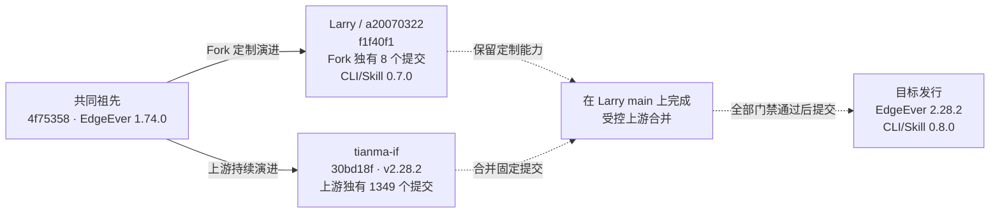
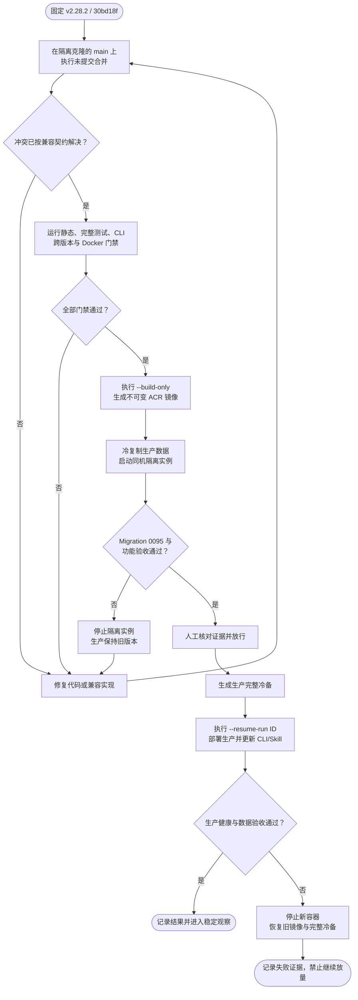

# EdgeEver v2.28.2 上游升级开发方案

> 状态：计划，尚未实施
> 编制日期：2026-11-17
> 当前生产基线：`LarryGuan/edgeever@f1f40f16987eb4ba04cdcb6ed77184130c2b3112`
> 固定上游目标：`tianma-if/edgeever@30bd18fdfa48118da265f849b974f9fbd2f0f46f`（`v2.28.2`）

## 1. 决策摘要

本次升级继续使用 `LarryGuan/edgeever` 作为唯一生产部署源，把固定的上游 `v2.28.2` 合并进现有定制 Fork。升级必须保留独立 CLI、Claude/Codex Skill、文件工作区协议、附件同步、编辑会话保护和原子 revision 写入。

不直接部署 `tianma-if/edgeever`，因为上游不包含本 Fork 的 `cli/`、文件工作区实现和配套服务端扩展；也不再通过 `a20070322/edgeever` 中转后续同步，因为它当前与 Larry 的 `main` 完全相同。

本次范围只包含 Docker 自托管 Web/API 与独立 CLI/Skill。桌面、Android、iOS、Cloudflare 和官方多平台 Release 不在本次交付范围内。

## 2. 状态与证据边界

本文使用以下标记，避免把计划误写成已完成事实：

- **已核验**：已从 Git 历史、当前仓库或生产服务器只读检查获得。
- **计划**：实施时必须完成，但尚未执行。
- **实施记录**：完成后回填真实提交、流水线、镜像、备份和验证结果；本文初始版本不得预填成功结论。

### 2.1 已核验事实

| 项目 | 当前结果 |
| --- | --- |
| 共同祖先 | `4f753587f66de8c150dd9a39660580457911a7a9` |
| Larry 与 a20070322 | `main` 均为 `f1f40f1`，提交差异 `0/0` |
| Fork 独有历史 | 8 个提交，其中 6 个功能/文档提交、2 个上游合并提交 |
| 上游独有历史 | 1349 个提交 |
| 应用版本 | `1.74.0` → `2.28.2` |
| 数据库 Migration | 当前 `0050`，目标 `0095` |
| Fork 改动文件 | 53 个 |
| 与上游同时改动 | 7 个文件 |
| 预演文本冲突 | 4 个：`memo-service.ts`、`resource-routes.ts`、`package.json`、`bun.lock` |
| 当前生产镜像 | `registry.cn-hangzhou.aliyuncs.com/larryguan/edgeever_zzy:2026-09-20-13-59-23` |
| 当前生产数据 | `/data/edgeever/data` 约 6.9 MB；SQLite 约 2.7 MB |
| 服务器余量 | 磁盘约 9 GB；可用内存约 4.2 GB；4 vCPU |

这些容量足以在同一服务器运行短期隔离验证实例，但不能让生产实例与验证实例共享同一个 SQLite 或资源目录。

## 3. 代码关系与目标

下图回答“代码从哪里分叉，以及本次合并形成什么结果”。实线表示已核验的提交演进，虚线表示计划动作。



## 4. 必须保持的兼容契约

服务端升级后仍必须支持以下契约，`protocolVersion` 保持为 `1`：

| 接口/行为 | 保持要求 | 验证重点 |
| --- | --- | --- |
| `GET /api/v1/file-workspace` | 返回 workspace 身份、原子 revision 写入与附件同步能力 | 旧 CLI 能完成 capability probe |
| `POST /api/v1/memos/:id/edit-sessions` | 建立绑定 revision/content hash 的编辑会话 | 过期会话不能覆盖较新正文 |
| `GET /api/v1/memos/:id/resources` | 仅返回当前 workspace 内该笔记的附件 | 跨 workspace 不可见 |
| `GET /api/v1/resources/:id` | 返回当前 workspace 内的资源元数据 | 越权 ID 返回拒绝或不存在 |
| 原子 revision 写入 | 读版本过期时整批写入失败 | 返回结构化 `409 revision_conflict`，不得部分提交 |
| 附件同步 | 正文、元数据和二进制附件保持一致 | 下载哈希、删除和冲突恢复正确 |

独立 CLI 与 Skill 计划从 `0.7.0` 升级到 `0.8.0`，明确新的服务端兼容基线为 EdgeEver `2.28.2`。CLI 的本地工作区状态升级必须保留历史、冲突草稿、目录绑定和附件，不允许静默重建工作区。

## 5. 合并实施方案

### 5.1 隔离工作区与固定基线

仓库规范禁止新增分支，因此实施时使用独立克隆，在其 `main` 上进行未提交合并；原生产工作目录保持不动。

```bash
git clone https://github.com/LarryGuan/edgeever.git edgeever-upgrade-v2.28.2
cd edgeever-upgrade-v2.28.2
git checkout main
git remote add upstream https://github.com/tianma-if/edgeever.git
git fetch --no-tags upstream tag v2.28.2
test "$(git rev-list -n 1 v2.28.2)" = "30bd18fdfa48118da265f849b974f9fbd2f0f46f"
git merge --no-commit --no-ff 30bd18fdfa48118da265f849b974f9fbd2f0f46f
```

若固定提交校验失败或出现超出本方案的结构性冲突，执行 `git merge --abort` 并停止，不得改用浮动的 `upstream/main` 继续。

### 5.2 冲突处理

1. `apps/api/src/memo-service.ts`
   - 以上游 `2.28.2` 的数据模型、事务顺序和新增业务逻辑为主体。
   - 重新接入 Fork 的 compare-and-swap revision 守卫。
   - revision 过期必须中止整个 batch，并转换为 `409 revision_conflict`；元数据、搜索索引、审计和正文不得部分写入。

2. `apps/api/src/resource-routes.ts`
   - 保留上游 pending resource、发布和存储逻辑。
   - 恢复两个只读资源接口，并复用上游的 workspace 鉴权和映射函数。
   - 资源查询必须同时约束 `workspace_id` 与 memo/resource ID。

3. `package.json`
   - 采用上游 `2.28.2` 的版本、脚本和依赖集合。
   - 恢复根工作区所需的 `@lezer/markdown: 1.7.2`。
   - 将独立 CLI/Skill 版本更新为 `0.8.0`；根应用与 CLI 保持独立版本号。

4. `bun.lock`
   - 禁止手工拼接冲突块。
   - 完成 `package.json` 后使用 Bun `1.3.14` 重新生成，审查依赖来源与异常大范围降级，再用 frozen lockfile 重装验证。

### 5.3 自动合并后的语义复核

- `memo-routes.ts`：capability probe 与 edit-session 路由仍受正确 scope 保护。
- `mcp-tool-service.ts`：revision 冲突仍保留错误码、HTTP 状态和可诊断消息。
- `.github/workflows/sync-edgeever-upstream.yml`：继续禁止无人值守覆盖定制 Fork；今后上游同步只能人工评审。
- `Dockerfile` 与自托管入口：CLI 扩展不改变 Web/API 镜像的运行用户、`/data` 语义和健康检查。
- `knowledge-workbench-image.yml`：若继续保留，仓库门禁与镜像命名改为 Larry；不得在无效的 a20070322 门禁下声称 CI 已执行。

## 6. 构建与发布门禁

### 6.1 新增 `--build-only`

`auto/update.sh` 计划新增显式模式：

```bash
./auto/update.sh --build-only
```

该模式必须：

1. 安全同步 Larry `main`，运行 CLI 安装、测试和打包预检。
2. 触发云效流水线并只等待镜像构建成功。
3. 在部署任务为 `SWITCH_MANUAL` 时停止，绝不调用手动部署 API。
4. 输出可复制的 `pipelineRunId`、不可变 ACR 镜像地址和下一步命令。
5. 不安装本机 CLI/Skill，不更改生产容器。

建议的稳定输出字段：

```text
pipelineRunId=<id>
image=registry.cn-hangzhou.aliyuncs.com/larryguan/edgeever_zzy:<immutable-tag>
next=./auto/update.sh --resume-run <id>
```

`--build-only`、`--run`、`--resume-run` 和 `--dry-run` 必须互斥。构建失败、镜像制品缺失或部署任务已被启动时返回非零状态。

### 6.2 首次升级发布规则

本次跨版本升级禁止直接使用一体化 `--run`。流程必须是：

```text
--build-only → 同机隔离验证 → 人工确认 → --resume-run ID
```

日常小版本发布是否恢复使用 `--run`，在本次生产稳定观察完成后再决定。

## 7. 验证门禁

### 7.1 合并与静态门禁

```bash
rg -n '^(<<<<<<<|=======|>>>>>>>)' .
bun install
bun install --frozen-lockfile
bun run typecheck
bun run typecheck:mobile
bun run build:web
bun run test
bun x tsc -p tsconfig.file-workspace.json --noEmit
bun test scripts/file-workspace/core.test.mjs \
  apps/api/src/memo-routes.test.mjs \
  apps/api/src/resource-routes.test.mjs \
  apps/api/src/mcp-routes.test.mjs \
  apps/api/src/mcp-tools.test.mjs
npm ci --prefix cli --ignore-scripts --no-audit --no-fund
npm test --prefix cli
```

通过标准：无冲突标记；全部命令退出码为 0；四项服务端契约均有正向、越权和冲突测试；53 个 Fork 改动文件都有“保留、由上游替代或删除”的明确归属。

### 7.2 CLI 跨版本验证

- 保存可安装的 CLI `0.7.0` tgz，建立包含目录绑定、附件、历史和未解决冲突的真实旧工作区夹具。
- 使用 CLI `0.8.0` 先执行 dry-run，再执行工作区状态迁移。
- 验证旧 CLI 拒绝打开新状态；新 CLI 保留正文、附件、绑定、冲突草稿和 GC 引用。
- 对打包后的 tgz 做独立安装测试，不能只从源码目录运行。

### 7.3 Docker 镜像门禁

```bash
docker build --platform linux/amd64 \
  --build-arg EDGE_EVER_BUILD_ID="$(git rev-parse HEAD)" \
  --tag edgeever-upgrade:v2.28.2-custom .
```

使用空数据卷验证首次启动、Migration `0001 → 0095`、鉴权和 `/api/health`。空数据库验证只是补充，不能替代生产数据副本验证。

## 8. 同服务器隔离迁移验证

### 8.1 边界与维护窗口

- 预留 10 分钟维护窗口；按当前 6.9 MB 数据量，实际冷复制预计明显短于该窗口，但不得将预计时间写成保证。
- 生产路径保持 `/data/edgeever`。
- 验证路径固定为 `/data/edgeever-upgrade-v2.28.2`。
- 验证 Compose project 固定为 `edgeever-upgrade-v2282`。
- 验证实例只监听 `127.0.0.1:18787`，不配置 1Panel/OpenResty 公网入口。
- 两个实例禁止共享 SQLite、resources、Compose project 或容器名。

### 8.2 冷副本步骤

1. 记录生产镜像、Migration、容器健康状态，以及 memo/notebook/resource 数量。
2. 停止生产 EdgeEver，等待优雅退出和 SQLite WAL checkpoint。
3. 将完整 `data/`、`compose.yaml`、`.env` 和 `image.env` 保存到带 UTC 时间戳的只读备份目录。
4. 从冷备份复制独立的验证数据目录，保持 UID/GID `1000` 和原权限。
5. 立即恢复生产旧容器并确认公网 `/api/health`。
6. 使用 `--build-only` 输出的不可变镜像启动隔离验证实例。

### 8.3 隔离实例验收

- `/api/health` 返回 `ok: true`，Migration 为 `0095`。
- 管理员登录成功；升级前后的 workspace、notebook、memo、resource 数量符合迁移预期。
- 抽样读取正文和附件；附件下载哈希一致。
- Web 完成列表、搜索、打开、编辑、新建、附件上传下载和删除恢复。
- CLI `0.8.0` 完成 capability probe、pull、push、并发 revision 冲突、附件同步、目录移动、冲突草稿与 GC。
- 容器日志无重复 Migration、SQLite 锁死、权限错误或持续 5xx。

隔离验证失败时，停止验证实例并保留数据副本、日志和镜像；生产继续运行旧版本。修复必须回到代码合并和门禁阶段，禁止直接修改生产数据验证猜测。

## 9. 生产放行与回退

### 9.1 放行

1. 确认隔离验证记录完整，并由人工明确放行。
2. 确认旧镜像 `2026-09-20-13-59-23` 仍可用。
3. 再次生成生产完整冷备，保存数据、Compose、`.env` 与 `image.env`。
4. 执行 `./auto/update.sh --resume-run <pipelineRunId>`。
5. 验证云效 build/deploy 均为 `SUCCESS`、公网健康、Migration `0095`、登录、笔记与附件。
6. 确认本机 CLI/Claude Skill 为 `0.8.0`，且 `~/.agents/skills/edgeever` 仍指向 `~/.claude/skills/edgeever`。

### 9.2 回退

若新容器在 Migration 后失败：

1. 停止新容器，阻止继续写入。
2. 保存失败现场的容器日志和数据副本，不在原目录上试修。
3. 恢复升级前的完整 `data/`、Compose、`.env` 和 `image.env`。
4. 使用旧镜像启动并验证健康、登录和数据抽样。

禁止只切回旧镜像而继续使用已经迁移到 `0095` 的数据库；Migration 不支持自动逆向撤销。

## 10. 升级控制流程图

下图回答“从合并到生产成功怎样推进，以及失败时停在哪里”。箭头表示下一控制步骤。



## 11. 实施记录

以下记录来自 2026-11-17 的实际升级；未执行项继续明确标注，不能从成功项推断。

| 项目 | 记录 |
| --- | --- |
| 合并提交 | `f027935f185d6ca8acafc6a3e5de35a9c812a6a8` |
| 上游目标校验 | 第二父提交为 `30bd18fdfa48118da265f849b974f9fbd2f0f46f`；第一父提交为 Larry 基线 `f1f40f16987eb4ba04cdcb6ed77184130c2b3112` |
| CLI/Skill 版本 | 本机 CLI `0.8.0`；Claude Skill `0.8.0`；`~/.agents/skills/edgeever` 继续软链到 `~/.claude/skills/edgeever` |
| 云效 pipelineRunId | `6`；build 与 deploy 均为 `SUCCESS` |
| ACR 镜像与摘要 | `registry.cn-hangzhou.aliyuncs.com/larryguan/edgeever_zzy:2026-11-17-17-29-48`；`sha256:57048895272559869bbe1b38e91fc40153a1c29bd7f818859f91bd04216f4b33` |
| 隔离验证备份目录 | 冷备 `/data/edgeever/backups/20261117T173337+0800-pre-v2.28.2`；实际隔离根目录 `/data/edgeever-staging/20261117T173337+0800-v2.28.2`；Compose project `edgeever-v2282-staging`，验证后已停止 |
| 生产备份目录 | `/data/edgeever/backups/20261117T095441Z-1029770`，包含 `.env`、Compose、`image.env` 和完整 `data.tgz` |
| Migration 结果 | 生产副本和生产均从 `0050` 成功迁移到 `0095_publish_animated_images.sql`；Migration `0078` 按设计清除 7 个内置默认笔记本旧颜色 |
| 测试与构建结果 | typecheck、mobile typecheck、Web build、文件工作区类型检查通过；完整测试 `5875/0`、API 集成 `17/0`、桌面定向 `24/0`（1 个 Windows 专用跳过）；定向 API/MCP `109/0`；CLI `24/0`；Linux amd64 镜像、隔离登录/Web/CLI/附件/冲突/GC 和生产回读通过 |
| 生产放行人和时间 | 用户在本会话授权升级；2026-11-17 17:55 CST 经 `--resume-run 6` 放行 |
| 回退演练/结果 | 未实际执行回退；旧镜像 `2026-09-20-13-59-23`、两份完整冷备及旧 CLI tgz 均已确认保留，未发生回退 |
| 证书恢复 | 续签失败根因为 Mihomo `auto` 节点不可用；未重装 OpenResty，使用现有 Certbot 完成公网 IP 证书续签并加入自动恢复网络状态的续签包装脚本 |
| 未验证平台 | 官方 Desktop、Android、iOS Release 与 Cloudflare 部署；本次只验证自托管 Web/API、独立 CLI/Skill 和 macOS 上的 headless Chrome Web 流程 |
